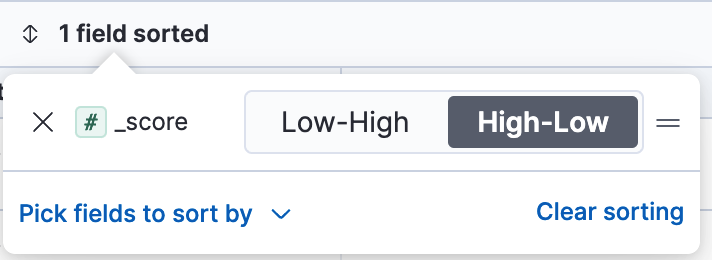

---
mapped_pages:
  - https://www.elastic.co/guide/en/kibana/current/discover-search-for-relevance.html
applies_to:
  stack: ga
  serverless: ga
type: how-to
products:
  - id: kibana
description: Sort results by relevance score in Discover to see the documents that best match your query first, in classic mode or with an ES|QL query.
---

# Search for relevance [discover-search-for-relevance]

{{product.elasticsearch}} assigns a relevancy score to each document based on how well it matches your query. Sorting by this score helps you identify the most relevant results quickly. This guide shows how to use **Discover** to sort documents by relevance score, putting the best matches at the top of your results.

:::::{tab-set}
:group: query-mode

::::{tab-item} {{esql}} mode
:sync: esql

This example uses the [sample web logs data](../index.md#gs-get-data-into-kibana), or you can use your own data.

1. In **Discover**, make sure you're in {{esql}} mode. If **Discover** opens in classic mode, refer to [Switch between {{esql}} and classic mode](switch-esql-mode.md#switch-discover-query-mode).
2. To get scores, request `METADATA _score` and filter with a full text search function such as `MATCH`. Then sort by `_score`. For the sample data, enter:

    ```esql
    FROM kibana_sample_data_logs METADATA _score
    | WHERE MATCH(message, "Mozilla")
    | SORT _score DESC
    | KEEP _score, message
    | LIMIT 10
    ```

3. If you don't see any results, expand the [time range](../query-filter/filtering.md), for example to **Last 7 days**.

**Result:** The table lists the best matches first, with their scores in the `_score` column.

:::{tip}
Very small scores show as `0` in the table. To see the difference between them, multiply the score in your query. For example, add `| EVAL score_x100000 = _score * 100000` before `KEEP`, and keep that column.
:::

For more about scores, refer to [Relevance scoring](/solutions/search/esql-for-search.md#esql-for-search-scoring) and to the [`_score` metadata field](elasticsearch://reference/query-languages/esql/esql-metadata-fields.md).
::::

::::{tab-item} Classic mode
:sync: classic

This example uses the [sample flights data set](../index.md#gs-get-data-into-kibana), or you can use your own data.

1. In **Discover**, if it opens in {{esql}} mode, [switch to classic mode](switch-esql-mode.md#revert-to-classic-mode). Then, from the {{data-source}} menu, select the data that you want to work with.

    For the sample flights data, set the {{data-source}} to **Kibana Sample Data Flights**.

2. Run your search.  For the sample data, try:

    ```ts
    Warsaw OR Venice OR Clear
    ```

3. If you don’t see any results, expand the [time range](../query-filter/filtering.md), for example to **Last 7 days**.
4. From the list of **Meta fields** list in the sidebar, add `_score`.
5. Add any other fields you want to the document table.

    You're sorting by the`timestamp` field.

6. To turn off sorting by the `timestamp` field, click the **field sorted** option, and then click **Clear sorting.**
7. Open the **Pick fields to sort by** menu, and then click **_score**.
8. Select **High-Low**.
   
   
   
   Your table now sorts documents from most to least relevant.
   :::{image} /explore-analyze/images/kibana-discover-search-for-relevance.png
   :alt: Documents are sorted from most relevant to least relevant.
   :screenshot:
   :::
::::

:::::
