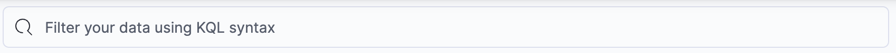
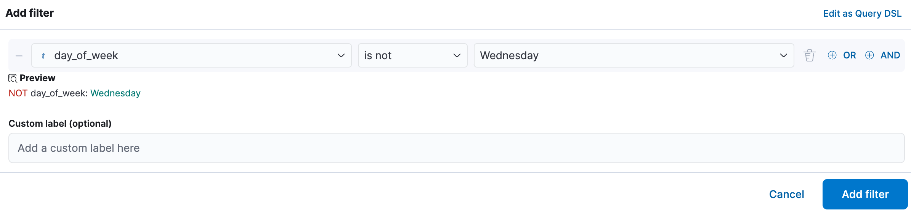

# Search and filter with KQL, Lucene, and filters in classic mode

In classic mode, you find the documents you need by searching a data view with [Kibana Query Language (KQL)](../query-filter/languages/kql.md) or [Lucene](../query-filter/languages/lucene-query-syntax.md), two search syntaxes, and narrowing the results with filters that you set in the interface. The chart and the results table update to show only the matching documents.

## Before you begin

- Open **Discover** in classic mode. If **Discover** opens in {{esql}} mode, refer to [Switch to Discover's classic mode](switch-esql-mode.md#revert-to-classic-mode).
- A [{{data-source}}](../find-and-organize/data-views.md) for the data you want to search. It can point to one or more indices, [data streams](../../manage-data/data-store/data-streams.md), or [index aliases](/manage-data/data-store/aliases.md). Integrations sometimes create data views for you, and you can also [create your own](../find-and-organize/data-views/create-data-view.md). If **Discover** asks you to add data or create a {{data-source}} instead of opening, refer to [](/troubleshoot/kibana/discover-dashboards-no-data-screen.md).
- To follow the examples, add the [ecommerce sample data](/manage-data/ingest/sample-data.md) and select its data view.

## Select a data view and a time range [find-the-data-you-want-to-use]

In classic mode, you select the data to explore with a data view, and then set the time range in which to view that data.

1. Select the data view that contains the data you want to explore.
   If you're using sample data, data views are automatically created and are ready to use.
   :::{image} /explore-analyze/images/kibana-discover-data-view.png
   :alt: How to set the {{data-source}} in Discover
   :screenshot:
   :width: 300px
   :::

2. If needed, adjust the [time range](../query-filter/filtering.md), for example by setting it to the **Last 7 days**.
    The range selection is based on the default time field in your data view. If you are using the sample data, this value was set when the data view was created. If you are using your own data view and it does not have a time field:

    - {applies_to}`serverless: ga` {applies_to}`stack: ga 9.6+` The time filter stays visible, shows **All time**, and cannot be changed.
    - {applies_to}`stack: ga 9.0-9.5` The range selection is not available.

3. Select **Update** or **Refresh**.

**Result:** **Discover** shows your data. By default, the table includes a column for the time field and a **Summary** column with an overview of each result.

## Search with KQL or Lucene

To search all fields, enter a text string in the search bar.



:::{note}
Free text searches that don't specify a field might not return the results you expect, depending on how the [`index.query.default_field` index setting](elasticsearch://reference/elasticsearch/index-settings/index-modules.md#index-query-default-field) is configured for the indices that match the current data view.
:::

To search particular fields and build more complex queries, use [KQL](../query-filter/languages/kql.md). As you enter text, KQL prompts you with the fields you can search and the operators you can use to build a structured query. To use [Lucene](../query-filter/languages/lucene-query-syntax.md) instead, switch the query language of the search bar.

For example, search the ecommerce sample data for documents where the country matches US:

1. Enter `g`, and then select **geoip.country_iso_code**.
2. Select **:** for equals, and **US** for the value, and then select the refresh button or press Enter.
3. For a more complex search, try:

    ```ts
    geoip.country_iso_code : US and products.taxless_price >= 75
    ```

**Result:** The chart and the table show only the documents that match your query.

$$$filter-in-discover$$$

## Filter with the filter bar

Besides the search bar, you can build filters one by one with **Add filter**, or define them as [Query DSL](../query-filter/languages/querydsl.md).

For example, exclude results from the ecommerce sample data view where the day of the week is Wednesday:

1. Select  next to the search bar.
2. In the **Add filter** pop-up, set the field to **day_of_week**, the operator to **is not**, and the value to **Wednesday**.

    

3. Select **Add filter**.
4. Continue your exploration by adding more filters.
5. To remove a filter, select the close icon (x) next to its name in the filter bar.

**Result:** The filter appears in the filter bar, and the chart and the table exclude the documents that it matches.

### Filter pill actions

:::{include} ../_snippets/global-filters.md
:::

## Cancel a running query [cancel-query-in-discover]

:::{include} ../_snippets/discover-cancel-query.md
:::

## Related pages

- [Use Discover in classic mode](use-classic-mode.md)
- [Search for relevance](discover-search-for-relevance.md)
- [Kibana Query Language](../query-filter/languages/kql.md)
