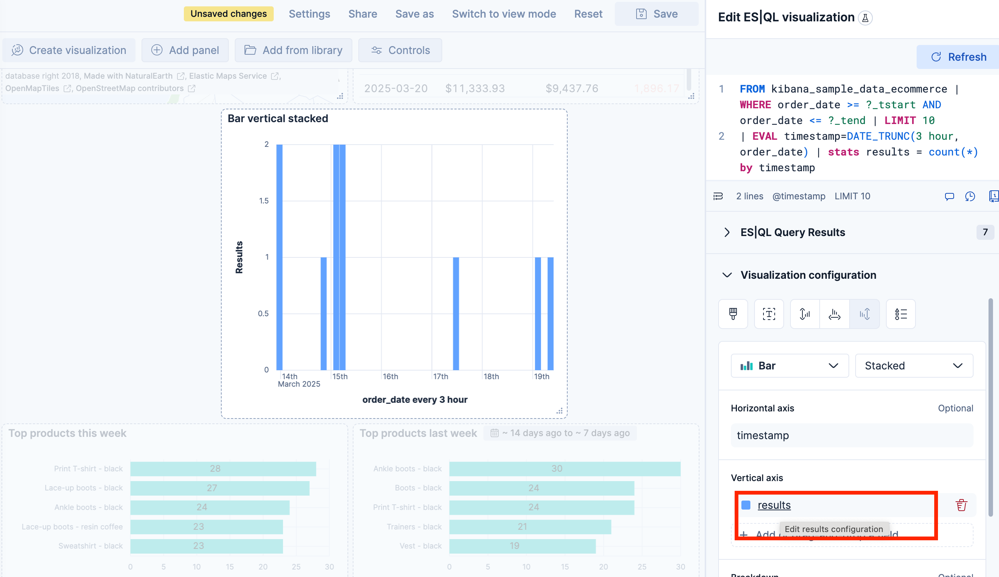
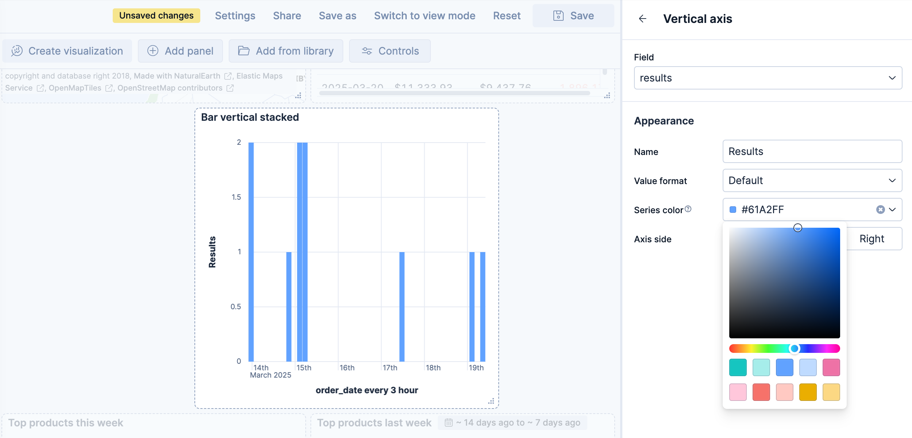
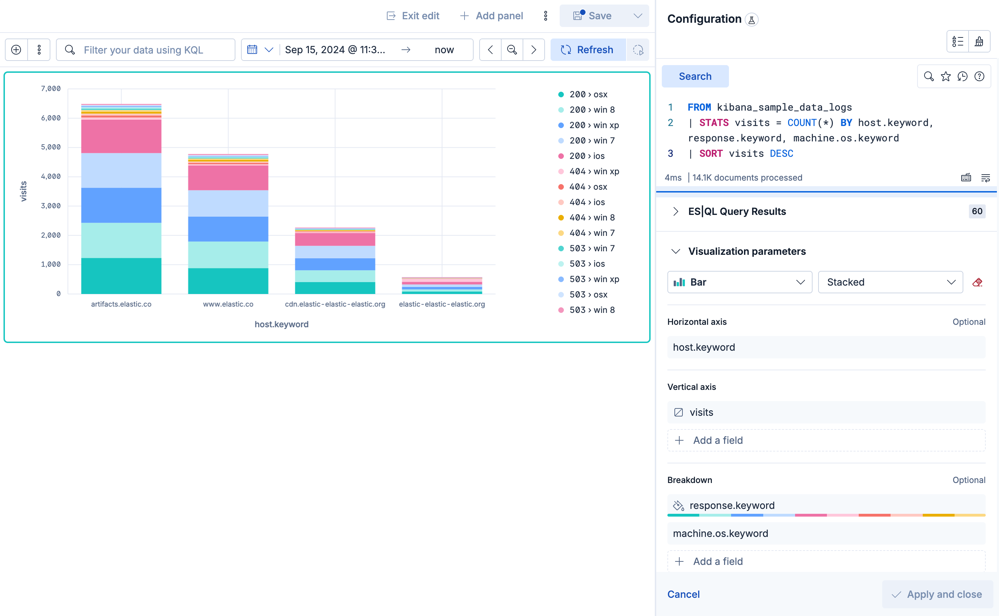
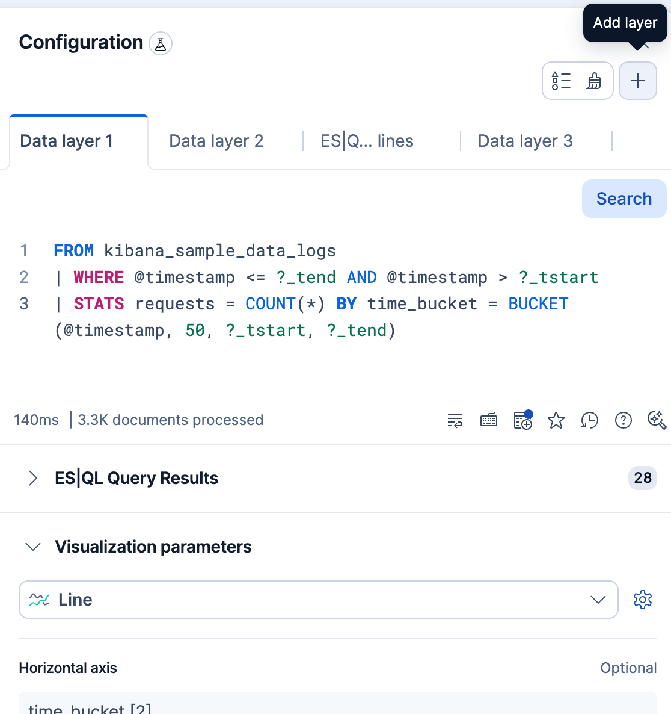

# Lens visualizations using ES|QL queries [esql-visualizations]

Creating visualizations using an {{esql}} query is particularly useful when you need to:

- Query data across multiple indices without a pre-configured data view
- Apply complex filtering, transforms, or custom calculations in a single query
- Prototype a visualization directly from an {{esql}} query in Discover

For less advanced aggregations on a known index, [the point-and-click mode](lens.md) is a good alternative.

You can add {{esql}} visualizations to a dashboard directly from queries in Discover, or you can start from a dashboard.

:::{note}
:applies_to: {"stack": "preview 9.5", "serverless": "preview"}
If your visualization's query uses exactly one `STATS` command, dashboard users can turn on {icon}`bolt` **Fast mode** to get faster, estimated results for it. Refer to [](/explore-analyze/query-filter/languages/esql-kibana.md#approximation-fast-mode).

{applies_to}`serverless: preview` {applies_to}`stack: preview 9.6+` A {icon}`bolt` badge in the panel header shows when approximation was applied. Refer to [Interpret approximate results](/explore-analyze/query-filter/languages/esql-kibana.md#esql-kibana-approximation-columns).
:::

## Edit and add from Discover [_edit_and_add_from_discover]

In Discover, an [ES|QL query](../query-filter/languages/esql-kibana.md) shows a visualization when the query transforms the results, for example, with `STATS` or `KEEP`, or when the results have a time field. The time field is `@timestamp`, or the field that the query compares with the `?_tstart` and `?_tend` parameters. The query determines the visualization type, such as a histogram or a bar chart. To change the visualization type and display options, select {icon}`pencil` **Edit visualization**.

To add the visualization to an existing or a new dashboard, select {icon}`app_dashboard` **Save visualization to dashboard**. In earlier versions, select {icon}`save` **Save visualization**.

## Create from dashboard [_create_from_dashboard]

1. Add a new panel from your dashboard.

    * {applies_to}`serverless:` {applies_to}`stack: ga 9.2+` Select **Add** in the application menu and, if required, **New panel**.
    * {applies_to}`stack: ga 9.0-9.1` Select **Add panel** in the application menu.

   ::::{tip}
   If you haven't created a [data view](/explore-analyze/find-and-organize/data-views.md) and you don't have a dashboard yet, the **Dashboards** page offers you the possibility to **Try ES|QL** right away. By selecting this option, a dashboard is created with an ES|QL visualization that you can interact with and configure using ES|QL.
   ::::

2. Select **Create visualization (query)** (**Visualization (query)** or **ES|QL** under **Visualizations** in earlier versions).

   An ES|QL editor appears and lets you configure your query and its associated visualization. The **Suggestions** panel can help you find alternative ways to configure the visualization.

   ::::{tip}
   Check the [ES|QL reference](elasticsearch://reference/query-languages/esql.md) to get familiar with the syntax and [optimize your query](elasticsearch://reference/query-languages/esql/esql-query-performance.md).
   ::::

3. When editing your query or its configuration, run the query to update the preview of the visualization.

    

    :::{note}
    :applies_to: { "stack": "ga 9.1+", "serverless": "ga" }

    When you edit the query and run it again, the visualization configuration persists as long as it is compatible with the query changes. Refer to [](#chart-config-persist) for more details.
    :::

4. You can bind controls to your ES|QL visualizations in dashboards by creating [ES|QL controls](add-variable-controls.md).
5. Select **Apply and close** to save the visualization to the dashboard.

### Customize the appearance of your {{esql}} visualization

When editing an {{esql}} visualization, you can customize the appearance of the chart. To do that:

1. Click one of the fields representing an axis of the chart to open its details.

   

2. Define the appearance of your choice from the available options.

   

3. Return to the previous menu, then **Apply and close** the configuration to save your changes.

### Break down a chart by multiple fields [esql-viz-multi-field-breakdown]
```{applies_to}
stack: ga 9.4
serverless: ga
```

On bar, line, and area charts built from an {{esql}} query, the **Breakdown** dimension can hold more than one field at the same time. Each unique combination of values is rendered as its own series, with the values joined by a `›` separator in the legend.

When the query groups a metric by more than one field, {{kib}} places the first field on the **Horizontal axis** and the remaining fields in the **Breakdown** dimension. For example, the following query counts web log events over time, broken down by host and file extension:

```esql
FROM kibana_sample_data_logs
| WHERE extension.keyword != ""
| STATS count(*) BY BUCKET(@timestamp, 100, ?_tstart, ?_tend), host.keyword, extension.keyword
```

In the resulting chart, the time buckets are placed on the **Horizontal axis**, while `host.keyword` and `extension.keyword` are combined in the **Breakdown** dimension. Each legend entry represents a unique combination, such as `artifacts.elastic.co › deb` or `artifacts.elastic.co › gz`.



To add another field to the breakdown, select **Add a field** under **Breakdown** and choose a column from your query. You can also drag the fields inside the **Breakdown** dimension to change the order in which their values appear in the combined label.

### Add multiple layers to ES|QL charts [esql-viz-multi-layer]
```{applies_to}
stack: ga 9.6
serverless: ga
```

If the series you want to compare come from different queries, you can plot each query in its own layer on the same chart. You can also add annotations and reference lines on top of the data. Layers are available on bar, line, and area charts. Other chart types, such as pie or metric, use a single query.

Every {{esql}} data layer has its own query and its own dimensions, so you can change one query without touching the others. To split the results of a single query into several series instead, use the [**Breakdown** dimension](#esql-viz-multi-field-breakdown).

To add a layer, select {icon}`plus` **Add layer** in the editor, then select the type of layer. The new layer opens in its own tab. When a chart has more than one layer, each layer has a tab, and you select a tab to edit that layer's query and dimensions.



The layer types work a little differently from the same layers in a point-and-click visualization, as the following sections describe.

#### Plot another query in its own layer

To compare two sets of results on one chart, add a layer with its own query. For example, start from the [time series chart](#esql-time-series-charts) that counts requests, then add a layer for the requests that ended in a server error (response codes that start with 5):

```esql
FROM kibana_sample_data_logs
| WHERE @timestamp <= ?_tend AND @timestamp > ?_tstart AND response.keyword LIKE "5*"
| STATS server_errors = COUNT(*) BY time_bucket = BUCKET(@timestamp, 50, ?_tstart, ?_tend)
```

To add it:

1. Select {icon}`plus` **Add layer** → **Visualization**.
2. If you're asked, select the chart type for the layer. Each layer can use a different type, for example a line over bars.
3. In the new layer's tab, enter the query and run it.
4. Assign `time_bucket` to the **Horizontal axis** and `server_errors` to the **Vertical axis**.

Check that both dimensions are set before you look at the chart. If the **Horizontal axis** of a layer is empty, the values of that layer don't follow time and stack at a single position.

Use the same time-bucket column on the **Horizontal axis** of each layer so the layers line up in time. To compare client errors (response codes that start with 4) as well, add a third layer the same way, with this query:

```esql
FROM kibana_sample_data_logs
| WHERE @timestamp <= ?_tend AND @timestamp > ?_tstart AND response.keyword LIKE "4*"
| STATS client_errors = COUNT(*) BY time_bucket = BUCKET(@timestamp, 50, ?_tstart, ?_tend)
```

If you edit a layer's query and its results no longer contain a compatible column for every dimension of that layer, {{kib}} rejects the query and shows an error. Remove the incompatible dimensions, then run the query again.

#### Mark events with annotations

Annotations mark an event or a period on a time chart, such as a deployment or an outage. The chart needs a time axis, so **Annotations** stays unavailable until the horizontal axis shows time.

Select {icon}`plus` **Add layer** → **Annotations**. {{kib}} creates a new annotation straight away. In a point-and-click visualization, you choose between a new annotation and one from the annotation library, and an annotation can be based on a query. {{esql}} charts offer neither. Each annotation is placed manually: set **Annotation date**, or turn on **Apply as range** and set **From** and **To**.

#### Add reference lines

A reference line shows a threshold, such as a target or a budget, so you can see at a glance where your data crosses it. How you add one depends on your version:

- {applies_to}`serverless: ga` {applies_to}`stack: ga 9.7+` Select {icon}`plus` **Add layer** → **Reference lines**, then select the source of the values:

    - **Static reference lines**: Enter fixed values. This layer has no query.
    - **ES|QL reference lines**: Calculate the thresholds with a separate query, independent of the queries of your data layers. Each column of numbers that the query returns can become a line.

- {applies_to}`stack: ga 9.6` Select {icon}`plus` **Add layer** → **Reference lines**, then enter fixed values.

In a point-and-click visualization, you add a reference line first, then choose in its settings how to calculate it, for example with a formula. On an {{esql}} chart, you choose the source when you add the layer.

{applies_to}`serverless: ga` {applies_to}`stack: ga 9.7+` For example, to draw a line at the average number of requests per time bucket, add an **ES|QL reference lines** layer with this query. It reuses the time-bucket query and averages its results:

```esql
FROM kibana_sample_data_logs
| WHERE @timestamp <= ?_tend AND @timestamp > ?_tstart
| STATS requests = COUNT(*) BY time_bucket = BUCKET(@timestamp, 50, ?_tstart, ?_tend)
| STATS average_requests = AVG(requests)
```

#### Suggestions with several layers

The **Suggestions** panel is hidden while the chart has more than one layer, because applying a suggestion would replace the other layers.

### Chart configuration persistence over {{esql}} query update [chart-config-persist]
```{applies_to}
stack: ga 9.1
serverless: ga
```

When you edit the {{esql}} query and run it again, the visualization configuration persists as you defined it as long as it is compatible with the query changes.

The chart configuration resets or follows automatic suggestions when:
- {applies_to}`stack: ga 9.2+` You manually select a different chart type incompatible with the one previously selected.
- {applies_to}`stack: ga 9.2+` You create a new chart and haven't edited the visualization's options yet.
- The query changes significantly and no longer returns compatible columns.

### Query data from multiple projects [esql-viz-cps]
```{applies_to}
serverless: ga
stack: unavailable
```

When [{{cps}}](/explore-analyze/cross-project-search.md) is enabled and you have [linked projects](/deploy-manage/cross-project-search-config/cps-config-link-and-manage.md), your {{esql}} visualization queries data based on the current [{{cps}} scope](/explore-analyze/cross-project-search/cross-project-search-manage-scope.md#cps-in-kibana).

To target specific projects from within the query, add [`SET project_routing`](elasticsearch://reference/query-languages/esql/directives/set.md) at the beginning of your {{esql}} query. When you do this, the visualization panel displays a **Custom CPS scope** badge on the dashboard, indicating that it uses a different scope than the {{cps-init}} scope selector. Refer to [View data from multiple projects](/explore-analyze/dashboards/using.md#dashboard-cps-scope) for details.

## Build specific chart types with an {{esql}} query [esql-chart-types]

An {{esql}} query returns a table. When you use the result to build a visualization, each returned column is available as a chart dimension. Shape the query result to provide the dimensions required by the chart:

| Result column | How to produce it | Common uses |
| --- | --- | --- |
| Grouping column | Return a source column, group values with a `BY` clause, or derive a column with `EVAL`. | Categories, rows, regions, series, and non-time axes |
| Time-bucket column | Group a time field with `BUCKET` or `DATE_TRUNC`. | The horizontal axis of a time-series chart |
| Numeric metric column | Calculate a value with a `STATS` aggregation such as `COUNT`, `SUM`, or `AVG`. | Plotted values, sizes, color intensity, metrics, and gauges |

The chart type determines the combination of columns you need. Open a page from the [visualization types](lens.md#lens-visualization-types) list to find an {{esql}} query pattern and learn how to assign its result columns to the chart dimensions.

## Build time series charts with {{esql}} [esql-time-series-charts]

A time series chart plots a metric over time. The query must return a time-bucket column for the **Horizontal axis** and a numeric metric column for the **Vertical axis**.

In this query, `WHERE` applies the dashboard time range, `BUCKET` divides that range into 50 groups, and `COUNT` returns one value for each group:

```esql
FROM kibana_sample_data_logs
| WHERE @timestamp <= ?_tend AND @timestamp > ?_tstart
| STATS requests = COUNT(*) BY time_bucket = BUCKET(@timestamp, 50, ?_tstart, ?_tend)
```

If your time field isn't named `@timestamp`, replace `@timestamp` with that field in both `WHERE` and `BUCKET`. Refer to [](../query-filter/languages/esql-kibana.md#_custom_time_parameters).

To build the chart:

1. [Create an {{esql}} visualization](#_create_from_dashboard) and run the query.
2. Set the visualization type to a chart type compatible with time series, typically **Line**, **Area**, or **Bar**.
3. Assign `time_bucket` to the **Horizontal axis** and `requests` to the **Vertical axis**.
4. Select **Apply and close**.

The chart preview shows how the request count changes over time.

For more query patterns and chart settings, refer to [Build a line chart with an {{esql}} query](charts/line-charts.md#build-a-line-chart-with-esql) and [Build an area chart with an {{esql}} query](charts/area-charts.md#build-an-area-chart-with-esql).

## Compare current versus previous period with time shift [esql-viz-time-shift]

:::{include} _snippets/esql-time-shift.md
:::

## Add drilldowns to an {{esql}} visualization [esql-viz-drilldowns]
```{applies_to}
stack: ga 9.4
serverless: ga
```

{{esql}} visualizations support the following [drilldown types](../dashboards/drilldowns.md#drilldown-types):

- [Dashboard](../dashboards/create-dashboard-drilldown.md) drilldowns: Open another dashboard from a data point.
- [URL](../dashboards/create-url-drilldown.md) drilldowns: Open an external URL from a data point.
- {applies_to}`stack: ga 9.5+` {applies_to}`serverless:` [Discover](../dashboards/create-discover-drilldown.md) drilldowns: Open **Discover** from a data point. Dashboard filters and the dashboard KQL or Lucene query are translated into the panel's ES|QL query, so the same context applies.

Drilldowns are compatible only with indexed fields. Fields created at query time are not supported. Refer to [Values that cannot open a drilldown](../dashboards/drilldowns.md#drilldowns-requirements).

## Ignore dashboard filters [esql-viz-ignore-dashboard-filters]
```{applies_to}
stack: ga 9.5
serverless: ga
```

By default, an {{esql}} visualization applies the filters and the KQL or Lucene query set at the dashboard level. To force a layer to run its query without these filters:
1. Select the {icon}`gear` **Settings** icon on the layer header.
2. Turn off **Use global filters**.

This option covers the dashboard's filter pills and the query from the search bar. The dashboard time range is a separate control that always applies, whether or not the option is turned on.

## Create an alert from your {{esql}} visualization
```{applies_to}
stack: ga 9.1
serverless:
   elasticsearch: ga
   observability: ga
   security: unavailable
```

Once you've created an {{esql}} panel, you can create an {{es}} threshold rule directly from the visualization panel, based on the data it displays. When you do this, the rule query is automatically generated and either describes the data and sets a specific threshold, or describes the data without setting a specific threshold.

::::{note}
{{elastic-sec}} rule types are not supported.
::::
To create a rule with the threshold pre-specified:

- Right-click a data point in the visualization and click **Add alert rule**. This opens the **Create rule** flyout. The generated query will define a threshold that corresponds to the data point you selected.
- [Configure](/solutions/observability/incident-management/create-an-elasticsearch-query-rule.md) your {{es}} rule.

To create a rule without the threshold pre-specified:

- Open the **More actions** (three dots) menu in the upper right of the panel and select **Add alert rule**. This opens the **Create rule** flyout. The generated query will define a threshold that corresponds to the data point you selected.
- [Configure](/solutions/observability/incident-management/create-an-elasticsearch-query-rule.md) your {{es}} rule.

## Use emojis in visualizations [esql-table-emojis]

:::{include} _snippets/emoji-table-esql.md
:::
