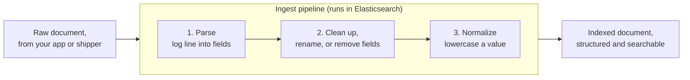

---
mapped_pages:
  - https://www.elastic.co/guide/en/elasticsearch/reference/current/ingest.html
applies_to:
  stack: ga
  serverless: ga
products:
  - id: elasticsearch
description: Learn what Elasticsearch ingest pipelines are, when to use them, and how to create, apply, and maintain them to transform documents before they're indexed.
type: overview
---

# {{es}} ingest pipelines [ingest]

You can set up ingest pipelines to perform common transformations on your documents as they reach {{es}} and before {{es}} indexes them. Because ingest pipelines run in {{es}}, they don't add processing overhead to the hosts that collect your data. To compare pipelines with other ways to transform data, such as {{agent}} processors and {{ls}}, refer to [Transform and enrich data](/manage-data/ingest/transform-enrich.md).

Use a pipeline to transform your data in any the following ways:

* Parse a log line into structured fields.
* Remove, rename, or redact fields.
* Normalize values, such as changing a field to lowercase.
* Enrich documents with data from another index.

A pipeline consists of a series of configurable tasks called [processors](elasticsearch://reference/ingest-processor/index.md). Each processor runs sequentially and makes specific changes to the incoming document. After the processors run, {{es}} adds the transformed document to your data stream or index.

The diagram shows a raw document passing through three processors in sequence (parse, clean up, and normalize), after which {{es}} indexes the result.

## When an ingest pipeline is the right fit [ingest-pipeline-limitations]

Ingest pipelines work best when each document can be transformed on its own as {{es}} indexes it. Some tasks fall outside that model:

* A pipeline can transform or drop a document, but it can't split one incoming document into multiple documents. To index each element of an incoming event as its own document, refer to [Split an event into multiple documents](/manage-data/ingest/transform-enrich/split-events-into-multiple-documents.md).
* A pipeline can't read from or aggregate across other indexed documents. The exception is the [enrich processor](/manage-data/ingest/transform-enrich/data-enrichment.md), which looks up data from an enrich index.
* A pipeline runs only when a document is indexed, and doesn't change documents that are already indexed. To run a pipeline on existing documents, [reindex]({{es-apis}}operation/operation-reindex) them into a new index with the pipeline, or run an [update by query]({{es-apis}}operation/operation-update-by-query) with the pipeline.

## Work with ingest pipelines [ingest-pipeline-workflow]

To start transforming your data, you create a pipeline, and then apply it to your data:

1. [Create and test an ingest pipeline](/manage-data/ingest/transform-enrich/create-ingest-pipelines.md). Define processors in {{kib}} or with the API, and test them with sample documents.
2. [Apply an ingest pipeline](/manage-data/ingest/transform-enrich/apply-ingest-pipelines.md). Choose how documents reach the pipeline.

As your pipelines grow more complex, use these pages to build and maintain them:

* [Access data in processors](/manage-data/ingest/transform-enrich/access-data-in-processors.md): read and write source fields, metadata, and template snippets.
* [Conditionally run processors and pipelines](/manage-data/ingest/transform-enrich/conditionally-run-ingest-processors.md): run a processor or pipeline only for documents that meet a condition, and avoid errors when a field in the condition is missing.
* [Create readable and maintainable ingest pipelines](/manage-data/ingest/transform-enrich/readable-maintainable-ingest-pipelines.md): simplify your pipelines and avoid common mistakes, with do and don't examples.
* [Error handling](/manage-data/ingest/transform-enrich/error-handling.md): decide what happens when a processor fails, so one bad field doesn't stop the pipeline, and record what went wrong.
* [Monitor and troubleshoot ingest pipelines](/troubleshoot/elasticsearch/troubleshoot-ingest-pipelines.md): check pipeline statistics and find slow or failing processors.

To see a pipeline built step by step, follow the [Parse logs](/manage-data/ingest/transform-enrich/example-parse-logs.md) example.
