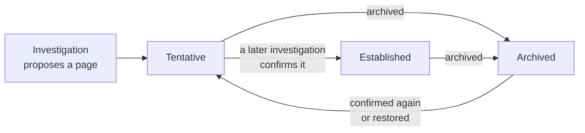

# Review and manage the Wiki [nightshift-wiki]

{{nightshift}} reads the Wiki before every investigation to learn about your services, integrations, and how your telemetry is laid out. Investigation start from what earlier investigations found, instead of rediscovering your system each time.

{{nightshift}} writes and maintains the Wiki. You can read Wiki pages, and archive the ones that are incorrect or outdated.

To open the Wiki, from the home page, select {icon}`boxes_vertical` → **Knowledge** → **Wiki**.

## What's in the Wiki [nightshift-wiki-content]

The sidebar lists the pages, grouped by type. Use **Search pages** to find a page, and the status filter to show all pages or only **Established** or **Tentative** ones.

- **Home** shows how many pages there are, how many are established, how often later investigations confirmed them, and when the Wiki last changed. It lists the **Most corroborated** and **Recently updated** pages.
- **Activity** lists the changes that investigations made to the Wiki, most recent first.

Each page covers a single topic, such as a service or an integration, and has a type.

| Type | What a page describes | Example |
| --- | --- | --- |
| **Services** | A service or database, what it depends on, and where its telemetry is An API service, the database it uses |
| **Integrations** | A data source or tool, and how to query it | Elasticsearch telemetry cluster (OTel data streams) |
| **Alerts** | An alert, what it usually means, and what to check | |
| **Runbooks** | Steps that resolved a problem before | |
| **Queries** | Queries that proved useful | |
| **Dashboards** | Dashboards that show the right data | |
| **Postmortems** | What happened in a past incident | |
| **Topics**, **Glossary**, **Ontology** | Terms, naming conventions, and how your entities relate | |

Investigations also note on integration pages which queries or tools failed, and any workarounds. That way, the next investigation avoids the same dead end.

## How pages become established [nightshift-wiki-status]

A page that {{nightshift}} writes after one investigation is **Tentative**. When a later investigation finds the same facts in your data, it corroborates the page, and the page becomes **Established**.

1. After an investigation, {{nightshift}} proposes pages or updates to existing ones. A page starts as **Tentative**.
1. When a later investigation confirms the page, the page becomes **Established**. Its corroboration count goes up each time this happens.
1. When you or {{nightshift}} archive a page, investigations stop loading it.
1. When a later investigation confirms an archived page, or you restore it, the page comes back as **Tentative**, not **Established**.

A statement in a chat alone doesn't confirm a page. The facts must come from what an investigation found in your data.

## Archive or restore a Wiki page [nightshift-wiki-archive]

You can't edit Wiki pages. When a page is wrong or out of date, archive it. Archiving keeps the page, so you can restore it later. You need the privileges listed in [Grant access](../get-started/privileges.md#nightshift-privileges-analyst).

1. On the **Wiki** tab, select the page.
1. Select **Archive**, and confirm.

Investigations stop loading the page. To use it again, set the status filter to **Archived**, open the page, and select **Restore**.

Archiving only stops {{nightshift}} from using a page. To tell it what's right instead, add [custom context](./index.md#nightshift-context-custom).

## Learn more [nightshift-wiki-next]

- [Memory](./memory.md): Check the lessons that {{nightshift}} recalls for similar problems.
- [How {{nightshift}} builds context](./index.md): Compare the Wiki with the other types of context.
- [How investigations work](../investigation/index.md): Learn how an investigation uses the Wiki while it runs.
