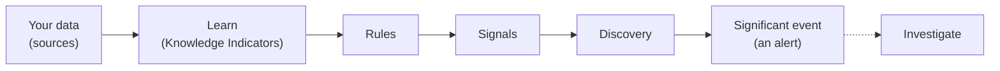

# Detection [nightshift-detection]

Detection finds problems that your alerts won't catch, and you don't need to create rules to find them. {{nightshift}} learns which services and dependencies your logs describe, generates its own rules, and watches for unusual changes. When related changes show up across several services, it groups them into a single significant event that shows which services and databases are affected, giving you one problem to look at instead of multiple small alerts.

[Turn detection on](../get-started/detection.md) once and choose the data that it watches. After that, it runs in the background.

:::{image} ../../../images/nightshift-detections.png
:alt: The Detections page. The Detection engine shows Monitoring with counts of knowledge indicators, entities, rules, signals, and significant events. The Entities list is on the left and significant events with their status and severity are on the right
:screenshot:
:::

Open detection from the home page by selecting **Detections** or using the global search field instead. The **Signals** tab is only available in developer mode.

## From your data to a significant event [nightshift-detection-flow]

1. **You choose the data.** A source is an {{esql}} query that selects the logs to watch, such as all logs with `FROM logs*`.
1. **{{nightshift}} learns your system.** It samples each source and extracts Knowledge Indicators (KIs), facts such as the language a service is written in and the database it uses.
1. **It writes rules.** From the KIs, it generates {{esql}} rules that look for failure patterns in your services, such as lock timeouts in a database. High-severity match query KIs become rules automatically, and you can promote others. Refer to [Where rules come from](./rules-and-signals.md#nightshift-detection-rules-origins).
1. **Rules produce signals.** Rules run on a schedule. When the rate at which a rule matches changes significantly, for example a sudden spike, detection records a signal.
1. **Discovery checks the signals.** Discovery reviews related signals together with your KIs and current data, and tests whether they point to a real, current problem.
1. **{{nightshift}} raises a significant event.** When discovery confirms a problem, or can't rule it out, it opens a significant event with a summary, a severity, and a confidence.
1. **You investigate.** Start an investigation from the event to find the likely cause, or let an automation start it for you.

For example, when a database starts to time out on locks, the rules for database lock timeouts, for statement timeouts in the service that uses it, and for slow requests to that service can all spike at once. Instead of three alerts, you get one significant event, with all three signals as its evidence.

## Terms [nightshift-detection-terms]

| Term | What it is | Where you find it |
| --- | --- | --- |
| Source | An {{esql}} query that selects the data that detection watches. | **Sources** page |
| Knowledge Indicator (KI) | A fact that {{nightshift}} extracted from a source, such as a service, a database, or a dependency. Some KIs are queries that can become rules. | **Knowledge** → **Knowledge Indicators** |
| Entity | A service, database, or other component that {{nightshift}} learned from your KIs. | **Entities** list on the **Detections** page |
| Rule | An {{esql}} query that runs on a schedule and counts the log lines that match one failure pattern. | **Rules** tab |
| Signal | A record that a rule's match rate changed significantly. Signals don't need any action from you. | **Signals** tab (developer mode), and the **Detections** list of each event |
| Significant event | A problem that discovery confirmed from one or more signals, with a severity, a confidence, and a status. | **Events** tab |

A significant event is an alert. You can route it to your team and act on it like any other alert, and an automation can investigate it. Refer to [Route significant events and investigate them automatically](./significant-events.md#nightshift-detection-events-route).

## What detection does and doesn't do [nightshift-detection-scope]

- **It starts only when you ask.** Detection doesn't run until someone with the [privileges to manage sources](../get-started/privileges.md#nightshift-privileges-admin) selects the data to watch. Refer to [Choose what detection watches](./sources.md).
- **It watches logs only.** Detection learns from and watches logs. Sources for metrics or traces aren't supported yet. Sources apply to detection only: investigations query your logs, metrics, and traces without one. Refer to [What a source is](./sources.md#nightshift-detection-sources-what).
- **It watches data that this project can reach with {{esql}}.** That is your project and any project linked through {{cps}}. Detection doesn't use connectors, so the External {{es}} connector only helps investigations. For what works with each deployment type, refer to [Reference architecture](../reference-architecture.md).
- **It needs time to learn.** Expect the first KIs and rules within a few minutes, the first signals 40 to 100 minutes after you turn it on, and significant events only when something actually changes. Refer to [How long learning takes](./learning.md#nightshift-detection-learning-warmup).
- **It doesn't change your environment.** Detection reads your data and raises events. It doesn't investigate them unless you or an automation starts an investigation.
- **It can be wrong.** Each event shows its confidence and the signals behind it, so you can check why it was raised. Refer to [Check the evidence before you act](../investigation/index.md#nightshift-investigations-accuracy).

## What it costs and how to control it [nightshift-detection-cost]

Detection uses model tokens to learn KIs and run discovery. Cost grows with the number of sources, the amount of data, and how often learning runs. To limit it, refer to [What uses tokens](../cost-and-models.md#nightshift-cost-drivers). Rules also run as {{esql}} queries against your data every few minutes. For the query load and storage, refer to the [Operator guide](../significant-events/operator-guide.md#sig-events-op-impact).

## Work with detection [nightshift-detection-tasks]

| I want to… | Go to |
| --- | --- |
| Turn on detection and choose the data it watches | [Choose what detection watches](./sources.md) |
| Understand what {{nightshift}} learned about my system | [How detection learns your system](./learning.md) |
| Check the rules behind an event, or remove a noisy rule | [Rules and signals](./rules-and-signals.md) |
| Review significant events and investigate them | [Review significant events](./significant-events.md) |

## Learn more [nightshift-detection-learn-more]

- [Detect problems automatically](../use-cases/detect-problems.md): Follow the end-to-end use case, from turning detection on to your first investigated event.
- [How Significant Events works](../significant-events/how-it-works.md): Read the pipeline internals, for operators and engineers.
- [Operator guide](../significant-events/operator-guide.md): Check system impact, cost drivers, and recovery procedures.
