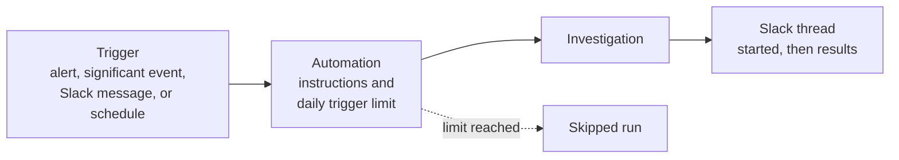

# Automations [nightshift-automations]

You can create an automation to start investigations on a schedule or when specific events occur, like an alert or a significant event fires or a message is sent to a Slack channel. {{nightshift}} can then send results to Slack.



1. **A trigger fires.** For example, a latency alert changes to **Active**.
1. **The automation checks its limits.** If a limit is reached, the run is skipped. Refer to [Investigation limits](./limits.md).
1. **It starts an investigation** with your instructions, or adds to an open investigation that already holds the alert.
1. **It posts to Slack** when the investigation starts, then replies in the same thread with the results.

## Before you begin [nightshift-automations-prereqs]

- {{nightshift}} is [enabled](../get-started/investigations.md#nightshift-get-started-enable).
- You have the privileges to create and edit automations. Without them, the edit actions on the **Automations** page are turned off, with a message that explains why. Refer to [Grant access](../get-started/privileges.md#nightshift-privileges-admin).
- To post results to Slack, an admin has [connected the Slack channel](./set-up.md#nightshift-set-up-slack).

To open the **Automations** page, select **Automations** on the {{nightshift}} home page.

## Create an automation [nightshift-automations-create]

1. On the **Automations** page, select **Create automation**.
1. Enter a **Name**. Optionally, add a **Description** and **Tags**.
1. Under **Trigger**, select **Add trigger** and choose what starts the automation. Refer to [Triggers](#nightshift-automations-triggers).
1. Check the **Daily trigger limit**. The default is 20 a day. Refer to [Daily trigger limit](#nightshift-automations-daily-limit).
1. Enter **Additional Instructions**, or **Instructions** for a schedule. Refer to [Instructions](#nightshift-automations-instructions).
1. Under **Actions**, select **Add action**, then **Post in Slack**, and search for a channel. If no channel is connected, select **Connect channels in Settings**.
1. Select **Save and enable** to turn the automation on now, or **Save** to save it turned off.

The automation appears on the **Automations** page. When its trigger fires, it starts an investigation, and the run appears in its [run history](#nightshift-automations-run-history).

For a guided example, refer to [Automatically investigate your alerts](../use-cases/auto-investigate-alerts.md).

## Triggers [nightshift-automations-triggers]

The trigger picker groups triggers under **Elastic**, **Slack**, and **Scheduled**.

:::{image} ../../../images/nightshift-automation-create-trigger.png
:alt: The Create automation flyout with the Add trigger menu open, offering Alert triggered under Elastic, New message in channel under Slack, and Every... under Scheduled
:screenshot:
:::

| Trigger | Starts an investigation when | Options |
| --- | --- | --- |
| **Alert triggered** | An alert or a significant event in this project changes to **Active**. | Alert sources, severity, and rules. |
| **New message in channel** | A message arrives in a connected Slack channel. | Channels, message text, sender, and app. |
| **Every…** | A scheduled time arrives. | Hour, day, or week, a time, and a time zone. |

### Alert triggered [nightshift-automations-trigger-alert]

By default, the trigger matches alerts from any rule. To narrow it:

- **Sources:** Select **any source** to choose where alerts come from: **Classic**, **Universal rules**, **Significant events**, or **External sources**. Select **Only these sources** or **All except these**.
- **Severity:** Select **Any severity** to match only some alert severities.
- **Rules:** Select **Any rule** to search for rules or rule tags, and select the ones to match. A tag selects every rule with that tag, including rules that you add later.

To investigate every significant event that detection raises, select **Only these sources** and **Significant events**.

An alert or significant event that's already part of an open investigation joins it. A new alert from the same rule starts its own investigation, and automations can't group repeat firings into one. A rule that fires often can use up the daily limit. Match only the rules that you want investigated. Refer to [One problem, one investigation](./index.md#nightshift-investigations-dedup).

**External sources** are alerts that don't come from an Elastic rule, for example alerts that another tool creates through a webhook. Refer to [Investigate alerts from your other tools](../use-cases/external-alerts.md).

### New message in channel [nightshift-automations-trigger-slack]

Use this trigger when alerts or reports already arrive in a Slack channel, for example from a paging tool.

1. In **Select channels**, select one or more connected channels.
1. Optionally, narrow which messages start the automation:

   - **Any message**: Match only messages that contain certain text, in **Message contains…**.
   - **Anyone**: Match only messages from certain people.
   - **Any app**: Match only messages that one app or bot posts. Enter its exact app name, app ID, or bot ID.

{{nightshift}} replies in the thread of the message that started the automation.

### Every… (schedule) [nightshift-automations-trigger-schedule]

Use a schedule for recurring checks, such as a daily health check of your main services at 09:00.

- **Hour**: Runs every hour. To run only during working hours, select **between hours** and set the **Start time** and **End time**, for example 09:00 AM and 05:00 PM.
- **Day**: Runs once a day at the time you set.
- **Week**: Runs at the time you set, on the days that you select in **Days of week**. Monday to Friday are selected by default.

Each schedule has a **Timezone**, which defaults to UTC. Custom cron schedules aren't supported. A scheduled automation needs **Instructions**, because there is no alert or message to start from, for example "Check the main services for error and latency changes in the last 24 hours, and report anything unusual."

You can give an automation more than one trigger, but only one schedule.

## Instructions [nightshift-automations-instructions]

Instructions tell the investigation what to focus on and what it needs to know about your system.

- For a schedule, **Instructions** are required. They define the task for each run.
- For an alert or Slack trigger, **Additional Instructions** are optional.
- Both can be up to 5,000 characters.

Good instructions include what an experienced teammate would tell an on-call engineer in their first week:

```text
The checkout and payment services share one Postgres database.
Lock timeouts in that database usually come from a nightly batch job.
Code: github.com/acme/checkout. Runbooks: https://runbooks.example.com/checkout.
The payments team owns both services. Check recent deploys first.
```

To give context to every investigation, not only this automation's, use custom context. Refer to [Give {{nightshift}} context](../context/index.md#nightshift-context-give).

## Post results to Slack [nightshift-automations-actions]

With a **Post in Slack** action, the automation posts a message to a connected channel when the investigation starts, and replies in that thread with the results. Refer to [Read investigation results in a thread](../use-cases/investigate-in-slack.md#nightshift-uc-slack-results).

:::{image} ../../../images/nightshift-slack-thread.png
:alt: A Slack thread under an alert message, where @Elastic replies with the investigation's Impact, Conclusion, and Hypotheses
:screenshot:
:::

Your team can ask follow-up questions in that thread. **Post in Slack**, through `@Elastic`, is the only action.

:::{image} ../../../images/nightshift-automation-create-actions.png
:alt: The Create automation flyout with the Add action menu open, offering Post in Slack as the only action
:screenshot:
:::

## Daily trigger limit [nightshift-automations-daily-limit]

The **Daily trigger limit** caps how many investigations this automation can start each day, so a noisy rule can't fire all day.

- **Default:** 20 a day when you create an automation. {{nightshift}} recommends 15 to 20.
- **Range:** 1 to 50. Above 30, the form shows a **High daily trigger limit** warning.
- **No limit:** Turn on **No daily limit** to remove the limit.
- **Reset:** The count resets at midnight UTC.

When the limit is reached, further triggers are skipped until the reset. Refer to [What happens when a limit is reached](./limits.md#nightshift-limits-reached).

The deployment-wide limits on the **Settings** page apply too. Refer to [Investigation limits](./limits.md).

## Manage automations [nightshift-automations-manage]

The **Automations** page lists the automations in the space. An icon next to each name shows its trigger.

:::{image} ../../../images/nightshift-automations-list.png
:alt: The Automations page with the Create automation button, the Status, Tag, Author, and Trigger filters, and a table of automations with their Successful, Failed, and Skipped runs, Today's usage against the limit, and an Enabled toggle
:screenshot:
:::

| Column | What it shows |
| --- | --- |
| **Automations** | The name and the trigger. |
| **Author** | Who created it. |
| **Enabled** | Whether it's on. Use the toggle to turn it on or off. A turned-off automation starts nothing. |
| **Today's usage** | The triggers used today, out of the daily trigger limit. |
| **Successful**, **Failed**, **Skipped** | The runs in the selected time range. Select a count to open those runs. |

To narrow the list, search by name, or filter by **Status**, **Tag**, **Author**, or **Trigger**. The time range defaults to **Last 48 hours**.

Open an automation's {icon}`boxes_vertical` menu for more actions:

- **Run**: Starts an investigation now. Only enabled automations with a schedule trigger, and no other trigger, can run on demand. A run on demand counts against the deployment-wide manual and all-investigations limits, not the automation's daily trigger limit.
- **Clone**: Copies the automation.
- **Delete**: Deletes the automation. You can't undo this.

When automations reach a limit, a message at the top of the page says so. Select **Show rate-limited automations** to find them, or **Open settings** to change the limits. The counts come from the first page of runs, so they can be low for a busy automation.

## Check what an automation did [nightshift-automations-run-history]

Select an automation's name to open its details.

:::{image} ../../../images/nightshift-automation-details.png
:alt: The details of a Slack-triggered automation, with the Enabled toggle, Today's usage of 1 out of 10, the Overview and Run history tabs, the trigger with a Daily trigger limit of 10 per day, the Additional Instructions, and the Post in Slack action
:screenshot:
:::

- The **Overview** tab shows the description, trigger, daily trigger limit, instructions, and actions. To change the automation, select **Edit**. A change applies from the next trigger. The **Actions** menu has **Run**, **Clone**, and **Delete**.
- The **Run history** tab shows a chart of the runs in the selected time range, with a count for each status: **Succeeded**, **Running**, **Failed**, and **Skipped**. Filter by status to narrow the list. Below the chart, runs are grouped by day.

% SCREENSHOT: The Run history tab of an automation with a mix of Succeeded and Skipped runs, one skipped run showing "Daily trigger limit of 20 reached".

Select a run to open its details. For a run that started an investigation, select **Open investigation**. Runs started with **Run** show **Manual** and the name of the person who started them.

A skipped run shows why. For each reason and how to raise the limit, refer to [Find out why a run was skipped](./limits.md#nightshift-limits-raise).

## The workflow behind an automation [nightshift-automations-workflow]

Each automation runs on a [workflow](/explore-analyze/workflows.md) that {{nightshift}} creates for it. The workflow has the same name as the automation, has the `nightshift` and `automation` tags, and appears on the **Workflows** page.

Change the automation, not its workflow. {{nightshift}} rewrites the workflow when you save the automation, and deletes it when you delete the automation.

Automations run as a service account, so they keep working when the person who created them leaves. Refer to [Privileges that {{nightshift}} runs with](../get-started/privileges.md#nightshift-privileges-accounts).

## Next steps [nightshift-automations-next]

- [Automatically investigate your alerts](../use-cases/auto-investigate-alerts.md): Follow a full example, from alert to Slack thread.
- [Investigation limits](./limits.md): Set how many investigations can start each day.
- [Connect your data and tools](./set-up.md#nightshift-set-up-slack): Connect the Slack channels that automations post to.
- [How investigations work](./index.md): Learn what an investigation does with each trigger.
