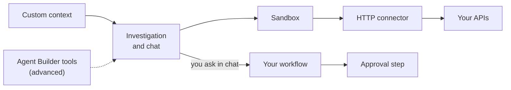

# Extend investigations: custom context, connectors, tools, and workflows [nightshift-extend]

Investigations work better when {{nightshift}} has notes about your environment and can reach the systems that your team uses. Tell it where your data and runbooks are, connect the APIs it can't reach yet, and run your own workflows from chat.

## How the extensions fit together [nightshift-extend-overview]



| Extension | What it gives investigations | Section |
| --- | --- | --- |
| Custom context | Notes about your environment and conventions, added to every investigation and chat. | [Custom context](#nightshift-extend-custom-context) |
| HTTP connector | Access to any system with an HTTP API, from the investigation sandbox. Custom context describes the API. | [Connect any system with an HTTP API](#nightshift-extend-http) |
| {{agent-builder}} tools | Custom tools that fetch more context. Advanced. | [Custom tools (advanced)](#nightshift-extend-tools) |
| Workflows | Actions that you build, with approval steps, run when you ask in chat. | [Run workflows from chat](#nightshift-extend-workflows) |

## Custom context [nightshift-extend-custom-context]

Custom context gives investigations the facts they can't find in your data, such as where your data lives, who owns a service, and what your team checks first. It's a set of short notes, called snippets. {{nightshift}} adds them to its instructions for every investigation and every chat in the space.

### Add custom context [nightshift-extend-custom-context-add]

To add a snippet, you need the privileges to open **Settings**. Refer to [Grant access](../get-started/privileges.md#nightshift-privileges-admin).

1. On the {{nightshift}} home page, open the {icon}`boxes_vertical` menu and select **Settings**.
1. Select the **Investigations** tab.
1. In **Custom context**, select **Edit investigation context**.
1. In the **Custom context** flyout, select **Add snippet**.
1. Enter your note.
1. Select **Save**, then **Close**.

:::{image} ../../../images/nightshift-settings-investigations.png
:alt: The Investigations tab of the Settings page. The Custom context section with the Edit investigation context button is below the daily run limits and the service account status.
:screenshot:
:::

The snippet now applies to the next investigation or chat that starts. To change or remove a snippet, open the flyout again and select **Edit snippet** or **Delete snippet**.

You can add up to 200 snippets. Each snippet can have up to 32,768 characters, and all snippets together up to 262,144 characters. Empty snippets are removed when you save.

### What to write [nightshift-extend-custom-context-write]

Write short, specific notes that are true for every investigation. Put one topic in each snippet, so you can update it on its own.

| Snippet type | Example |
| --- | --- |
| Where your data lives | "Logs for the checkout services are in `logs-checkout-*`. Production metrics are on the remote cluster `prod-eu`. Query them as `prod-eu:metrics-*`." |
| Service ownership | "The payments team owns the checkout services. The data platform team owns their Postgres databases." |
| Runbooks and code | "Runbooks are in the GitHub repository `acme/runbooks`, one file for each service in `services/`. The source for the checkout services is in `acme/checkout`." |
| Conventions | "While debugging alerts, always rule out a release or config regression first." |
| How to use an HTTP connector | "Use the `runbooks-api` connector to find the runbook for a service." Describe the API in full. Refer to [Describe the API in custom context](#nightshift-extend-http-context). |

Don't put secrets, such as API keys or passwords, in custom context. Use a connector for credentials.

Put facts about your environment in custom context, and what to check for one kind of alert in an automation's instructions. Refer to [Give {{nightshift}} context](../context/index.md#nightshift-context-give).

## Connect any system with an HTTP API [nightshift-extend-http]

Investigations can reach any system with an HTTP API through an HTTP connector, for example an incident tool, a status page, a CMDB, or a runbook service. Elastic plans to add built-in support for more common systems.

How an investigation uses an HTTP connector:

- **It calls the API from the sandbox.** Each investigation runs commands in its own temporary sandbox, and calls the API from there.
- **Credentials stay out of the investigation.** {{nightshift}} adds the connector's credentials to requests to the connector's host. The investigation's instructions and results don't include them.
- **The host is allowed automatically.** The connector's host is added to the sandbox egress allowlist. To reach other hosts, for example a host that the API redirects to, refer to [Sandbox egress allowlist](../settings.md#nightshift-settings-egress).

### Before you begin [nightshift-extend-http-prereqs]

- You have the privileges to open **Settings**. Refer to [Grant access](../get-started/privileges.md#nightshift-privileges-admin).
- The API uses HTTPS on port 443. In Tech Preview, requests to other ports fail with a `502` error.
- You have credentials for the API that can only read.

### Add an HTTP connector [nightshift-extend-http-add]

1. On the {{nightshift}} **Settings** page, on the **General** tab, select **Add connector**.
1. Next to **HTTP**, select **Create connector**.
1. Enter a **Connector name** that says what the API is, for example `runbooks-api`. {{kib}} suggests a **Connector ID**, which you can change before you save.
1. In **Base URL**, enter the base URL of the API, for example `https://runbooks.example.com`. Don't add a port number.
1. Under **Authentication**, select one of these options:

   - **None**: For APIs without authentication, or with an API key or token in a header. To send a key, turn on **Add HTTP header**, enter the header **Key** and **Value**, and set **Type** to **Secret**.
   - **Basic authentication**: Enter a **Username** and **Password**.
   - **OAuth 2.0 Client Credentials**: Enter the **Access token URL**, **Client ID**, **Client secret**, and **Scope** from your identity provider.
   - **OAuth 2.0 Password**: Enter the details from your identity provider, and the username and password.

1. Save the connector.

The connector now appears in the **Connectors** table, and investigations can use it. Next, describe the API in custom context.

Investigations can't use an HTTP connector with **SSL authentication**. When you edit the connector later, enter the username and password again.

For connectors in {{kib}}, refer to [Connectors](kibana://reference/connectors-kibana.md).

### Describe the API in custom context [nightshift-extend-http-context]

An investigation gets only the connector's name, ID, and type. It doesn't get the base URL, and nothing tells it what the API does or how to call it. Without custom context, an investigation can't use the connector well.

Add a snippet that says:

- Which connector to use, by name.
- The base path, and that authentication is added for you.
- The endpoints to call, with their method, parameters, and what they return.
- Paging, if the API pages its results.
- Which calls are safe, and which to never make.
- When to use the API.

For example, for an HTTP connector called `runbooks-api`, with the base URL `https://runbooks.example.com`. This API is an example. Write your snippet for your own API.

```text
Runbooks API: use the HTTP connector `runbooks-api` to find the runbook for a service.
- All endpoints are under /api/v1. Authentication is added for you. Don't ask for keys.
- GET /api/v1/runbooks?service=<service-name> returns a JSON list of the runbooks for
  that service, with id, title, owner, and updated_at. Results are paged, 20 for each
  page. Add &page=<n> for the next page.
- GET /api/v1/runbooks/<id> returns one runbook as Markdown, with its checks and
  remediation steps.
- Use only these GET endpoints. Never call POST, PUT, or DELETE.
- Use it when an alert or a question names a service, and before you propose an action
  for that service. Say which runbook you used in your findings.
```

## Custom tools (advanced) [nightshift-extend-tools]

You can build custom tools in {{agent-builder}} that fetch context, such as an {{esql}} query, an index search, or an MCP tool. Refer to [Tools in {{agent-builder}}](/explore-analyze/ai-features/agent-builder/tools.md) and [Skills in {{agent-builder}}](/explore-analyze/ai-features/agent-builder/skills.md).

:::{warning}
Investigations run as the **Nightshift Investigator** agent in {{agent-builder}}. You can add tools and skills to it, but this isn't tested or supported in Tech Preview. Use it at your own risk, and check your investigations after you change the agent. To edit an agent, refer to [Create and manage custom agents](/explore-analyze/ai-features/agent-builder/custom-agents.md).
:::

## Run workflows from chat [nightshift-extend-workflows]

In an investigation's chat, you can ask {{nightshift}} to run a workflow that you built, by name. For example: "Run the `restart-service` workflow" or "Run the `open-incident-ticket` workflow for this investigation". Refer to [Workflows](/explore-analyze/workflows.md).

{{nightshift}} itself never changes your environment. A workflow that you ask it to run does what you built it to do, with the connectors and permissions that it has. To keep a person in control, add an approval step before any step that changes something. The workflow then waits until someone approves or rejects it. Refer to [Human-in-the-loop workflows](/explore-analyze/workflows/authoring-techniques/human-in-the-loop.md).

Elastic plans to make running workflows from investigations more built in.

## Next steps [nightshift-extend-next]

- [Connect your data and tools](./set-up.md): Connect {{es}}, GitHub, and Slack.
- [How {{nightshift}} builds context](../context/index.md): Learn what {{nightshift}} learns on its own, and how your context fits in.
- [Automations](./automations.md#nightshift-automations-instructions): Give one automation its own instructions.
- [Settings and limits](../settings.md): Allow more hosts for the sandbox, and set run limits.
