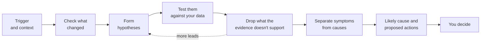

# How investigations work [nightshift-investigations]

An investigation takes a problem, such as a firing alert or a question in your own words, and returns the likely cause, the evidence, and actions you can take, usually within five minutes. It shows every explanation it tested, so you can check the reasoning. {{nightshift}} never changes your environment: you decide which actions to apply.

An investigation follows the method of an experienced on-call engineer:

1. **Start from the trigger and what it learned before.** An alert, a significant event, your question, a Slack mention, or an automation starts it. Refer to [Where investigations start](#nightshift-investigations-start). It reads the [Wiki](../context/wiki.md), [Memory](../context/memory.md), and your [custom context](../context/index.md#nightshift-context-custom) first.
1. **Check what changed.** It looks for recent changes, such as deploys and configuration changes, around the time the problem started.
1. **Form hypotheses.** Each hypothesis is a possible explanation, such as lock contention in a database, or a recent deploy that added errors.
1. **Test them.** It queries your logs, metrics, and traces, and reads your code in a temporary sandbox, only through the connectors you set up. It runs independent queries in parallel. Refer to [Connect your data and tools](./set-up.md).
1. **Drop what the evidence doesn't support.** Each hypothesis is confirmed or dismissed, with a confidence. What it finds can raise more hypotheses.
1. **Separate symptoms from causes.** A slow endpoint is a symptom. Lock contention in the database behind it is a likely cause.
1. **Report the likely cause and propose actions.** The conclusion has the evidence, the impact, and what it could not check. Actions are changes such as a configuration change, a rollback, or a query to run.
1. **You decide.** You apply the actions you agree with, and mark them as applied or declined.

To check how it reached a step, ask in chat, or open the [hypothesis tree](#nightshift-investigations-hypotheses): each hypothesis shows what was tested, the result, and the evidence behind it.

Afterwards, {{nightshift}} saves what it learned to the Wiki and Memory. Refer to [How {{nightshift}} builds context](../context/index.md).

## Where investigations start [nightshift-investigations-start]

| Start from | How | Learn more |
| --- | --- | --- |
| Your own question | On the {{nightshift}} home page, select **Investigate**, describe the problem, and select **Investigate**. For example, "Why is checkout latency up?" | [Investigate anything](../use-cases/investigate-anything.md) |
| An alert | In **Alerts**, open the alert's {icon}`boxes_vertical` menu or its details page, and select **Investigate**. | [Investigate your alerts](../use-cases/investigate-alerts.md) |
| An alert episode | In the episodes table or on the episode details page, select **Investigate** from the actions menu. | [Investigate your alerts](../use-cases/investigate-alerts.md) |
| A significant event | On the **Detections** page, on the **Events** tab, select **Investigate** in the event's row. | [Review significant events](../detection/significant-events.md) |
| Slack | In a connected public channel, mention `@Elastic` and describe the problem. | [Investigate in Slack](../use-cases/investigate-in-slack.md) |
| An automation | An automation starts investigations for you when an alert or a significant event fires, when a message arrives in a Slack channel, or on a schedule. | [Automations](./automations.md) |

Investigations that people start, from the home page, an alert, a significant event, or Slack, count toward the **Manual investigations daily limit**. Refer to [Investigation limits](./limits.md).

To find **Nightshift** or **Alerts**, use the navigation menu or the [global search field](/explore-analyze/find-and-organize/find-apps-and-objects.md).

### One problem, one investigation [nightshift-investigations-dedup]

- **Already investigated:** An alert or significant event that's already part of an open investigation joins it.
- **Each new alert counts separately:** A new alert from the same rule starts its own investigation, and automations can't group repeat firings into one.
- **Closed means closed:** An alert never joins a closed investigation. It starts another one.

To keep a noisy rule from starting many investigations, set a daily limit. Refer to [Investigation limits](./limits.md).

### How long it takes and who it runs as [nightshift-investigations-runtime]

- **Time:** Usually up to five minutes, at most 60 minutes. Refer to [Timeout and concurrency](./limits.md#nightshift-limits-timeout).
- **Identity:** Every investigation runs as the `nightshift_agent` service account, and reads what that account and your connectors can reach, which can be more or less than you can access. Refer to [Privileges that {{nightshift}} runs with](../get-started/privileges.md#nightshift-privileges-accounts).
- **Cost:** Each investigation uses model tokens. Refer to [Cost and models](../cost-and-models.md).

Its card on the home page shows **Investigating** while it runs and **Investigated** when the results are ready.

## Check the evidence before you act [nightshift-investigations-accuracy]

:::{important}
Investigations are written by a large language model, and the conclusion can be wrong. Elastic doesn't publish an accuracy rate for {{nightshift}}. Before you act on a conclusion:

- **Check the evidence.** Open the hypothesis tree and read what each hypothesis tested and found.
- **Read what it could not check.** The conclusion lists the data and tools that the investigation couldn't reach. A gap there can change the conclusion.
- **Treat Unresolved hypotheses as open.** A hypothesis shows **Unresolved** when the investigation couldn't confirm or dismiss it, for example because data was missing. It isn't ruled out.
- **Expect some variation.** Running the same investigation again can produce different hypotheses or a different conclusion.
- **Check the time range.** Investigations favor recent data. For an older alert, an investigation can report that the problem isn't happening anymore. Confirm that it looked at the right time.

If a conclusion is wrong, tell {{nightshift}} in chat, and decline the proposed actions that don't fit. For more questions about accuracy and control, refer to the [FAQ](../faq.md#nightshift-faq-control).
:::

## Read an investigation [nightshift-read-investigation]

Select an investigation's card on the [home page](../homepage.md), select **View investigation** on an alert, or follow a shared link. To share one, open the {icon}`boxes_vertical` menu on its card and select **Copy link**.

The investigation opens in a flyout. At the top, three fields help your team work together:

| Field | What it means |
| --- | --- |
| **Status** | **Open** or **Closed**. Close an investigation when the problem is handled. Closing it declines any proposed actions that still need review. |
| **Severity** | **Critical**, **High**, **Medium**, or **Low**. {{nightshift}} sets it, and you can change it. The home page groups investigations by severity. |
| **Assignees** | The people working on it. Select the plus icon to assign someone. |

Below the fields, read the investigation from top to bottom:

- **What's happened**: A short summary of the problem. The card below it shows what triggered the investigation, such as an alert or your question.
- **Impact**: What the problem affects, with a chart of the affected activity, for example failed requests per hour, and who is hit and how badly.
- **Conclusion**: The most likely cause, the evidence for it, and what {{nightshift}} could not check. Select **View hypothesis tree** to check the reasoning.
- **Proposed actions**: What you can do about it. Refer to [Decide on proposed actions](#nightshift-investigations-actions).

:::{image} ../../../images/nightshift-investigation-results.png
:alt: An investigation flyout for inventory-api slow GET /tickets, with the Status, Severity, and Assignees fields, the What's happened summary, the trigger card, and the Impact chart of failed calls
:screenshot:
:::

While the investigation runs, the flyout shows **Investigating…**. Until the first round ends, the investigation is named after what triggered it, such as the alert's rule name, or **New investigation**.

### Check the reasoning in the hypothesis tree [nightshift-investigations-hypotheses]

The hypothesis tree shows every explanation that {{nightshift}} tested, from the trigger to the conclusion.

1. In the investigation flyout, select **View hypothesis tree**.
1. Read the tree from top to bottom:

   - **Trigger**: What started the investigation.
   - **Hypothesis**: Each explanation that was tested. Each one shows **Confirmed** or **Dismissed** and a confidence percentage. While testing, it shows **Investigating**. If the investigation couldn't confirm or dismiss it, it shows **Unresolved**.
   - **Conclusion**: Connected to the hypotheses that support it.
   - **Proposed action**: The actions that follow from the conclusion, each with **High confidence**, **Medium confidence**, or **Low confidence**.

1. To read a hypothesis in full, select its card. The detail panel shows what was tested, the result, and the chart or query behind it.

:::{image} ../../../images/nightshift-hypothesis-tree-detail.png
:alt: The hypothesis tree with six hypotheses analyzed. The confirmed hypothesis, lock contention from a reconcile-batch database session at 95% confidence, is open in the detail panel with what was tested, the result, and a chart of inventory-api lock timeouts
:screenshot:
:::

Use **Fit to view** to fit the whole tree on screen. Close the detail panel to go back to the tree.

If a hypothesis is missing or wrongly dismissed, ask in chat. Refer to [Ask follow-up questions in chat](#nightshift-investigations-chat).

### Decide on proposed actions [nightshift-investigations-actions]

A proposed action is a change that could fix or mitigate the problem: a command to run, a configuration change, a code fix, a rollback, or a way to gather more information. Each one has a title, an explanation of why {{nightshift}} proposes it, and a note such as **Apply manually**.

{{nightshift}} doesn't run proposed actions. Make the change yourself, then record your decision:

1. In the **Proposed actions** section, select an action.
1. Read the explanation and decide whether it fits your system.
1. If it fits, make the change in your environment, then select **Mark as applied**.
1. If it doesn't fit, select **Decline** and optionally enter a reason.

Each action shows one of these statuses:

| Status | Meaning |
| --- | --- |
| **Needs review** | Nobody has decided on it yet. |
| **Applied** | Someone made the change and marked it as applied. To undo this, select **Mark as not applied**. The action is offered again. |
| **Declined** | Someone declined it, or the investigation was closed before anyone decided. |
| **Expired** | The action can no longer be decided on. |

The section header counts the closed actions, for example **1 of 3 actions closed**.

To mark actions as applied or declined, you need the privileges listed in [Grant access](../get-started/privileges.md#nightshift-privileges-analyst).

### Ask follow-up questions in chat [nightshift-investigations-chat]

Chat continues the investigation with its findings in context. Use it to understand a result, add a hypothesis, or check a fix.

1. In the investigation flyout, select **Open chat**. You can also select the chat icon on the investigation's card on the home page. The chat opens in Agent Builder, next to the investigation.
1. Ask your question. For example:

   | You want to… | Ask, for example |
   | --- | --- |
   | Understand the conclusion | "How did you reach this conclusion?" |
   | Look wider | "What else changed on this service around the same time?" |
   | Add a hypothesis | "Add and test a hypothesis that the slowdown started with the last deploy." |
   | Challenge a hypothesis | "I don't think this caused it. The query plan didn't change. Challenge that hypothesis." |
   | Check a fix | "I applied the fix at 15:10 UTC. Has latency returned to normal since then?" |

When you add or challenge a hypothesis, {{nightshift}} tests it and updates the hypothesis tree. Proposed actions also appear in the chat, with **Decline** and **Mark as applied**.

:::{image} ../../../images/nightshift-investigation-chat-action.png
:alt: The chat next to an investigation flyout. A proposed action card, Inspect and fix the tickets-by-email query plan, shows Needs review with Decline and Mark as applied buttons
:screenshot:
:::

Chat needs the privileges listed in [Grant access](../get-started/privileges.md#nightshift-privileges-analyst).

## Next steps [nightshift-investigations-next]

- [Investigate anything](../use-cases/investigate-anything.md): Start your first investigation from a question.
- [Connect your data and tools](./set-up.md): Give investigations more to work with, such as your code and your runbooks.
- [Automations](./automations.md): Have investigations start for you when an alert fires.
- [How {{nightshift}} builds context](../context/index.md): Review what {{nightshift}} learned from past investigations.
