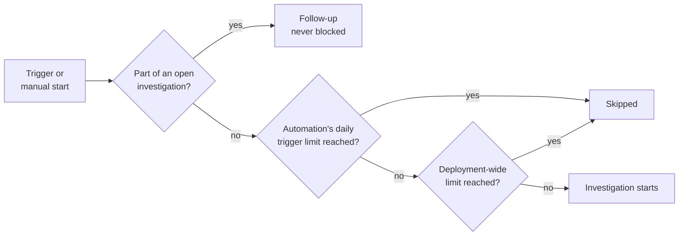

# Investigation limits [nightshift-limits]

Daily limits control how many investigations {{nightshift}} starts each day, so a noisy alert rule can't start hundreds of investigations or run up your token cost. Two kinds of limits work together: deployment-wide run limits on the **Settings** page, and a daily trigger limit on each automation.

## Limits at a glance [nightshift-limits-overview]

| Limit | Default | Applies to | Where to change it |
| --- | --- | --- | --- |
| Automatic investigations daily limit | 5 | All automations combined, deployment-wide | **Settings** → **Investigations** |
| Manual investigations daily limit | 5 | Investigations that people start, deployment-wide | **Settings** → **Investigations** |
| All investigations daily limit | 10 | Automatic and manual together, deployment-wide | **Settings** → **Investigations** |
| Daily trigger limit | 20 when you create an automation, up to 50 | One automation | The automation's settings |
| Investigation timeout | 60 minutes | Each investigation | Can't be changed |
| Rounds at a time | 1 | Each investigation | Can't be changed |

All daily limits count investigation starts, not tokens or cost, and reset at midnight UTC. For what an investigation costs, refer to [Cost and models](../cost-and-models.md).

## How a start is checked [nightshift-limits-check]

Before {{nightshift}} opens an investigation, it checks the limits in this order:

1. **Follow-ups always run.** If the alert or question belongs to an open investigation, it's added to that investigation. Follow-ups never count against a limit.
1. **The automation's own limit comes first.** For an automation, {{nightshift}} checks its daily trigger limit. Starts from people skip this check.
1. **Then the deployment-wide limits.** {{nightshift}} checks the automatic or manual limit, and the limit for all investigations.
1. **If a limit is reached, nothing starts.** The start is skipped or refused, and the counts don't change.

## Deployment-wide run limits [nightshift-limits-run]

The run limits apply to the whole deployment, across all spaces. Each one counts a different kind of start:

- **Automatic investigations daily limit**: Investigations that automations start, all automations combined.
- **Manual investigations daily limit**: Investigations that people start: from the home page, with **Investigate** on an alert or a significant event, with a Slack mention, or with the API or the CLI. **Run** on an automation counts here too.
- **All investigations daily limit**: Automatic and manual investigations together. It can be lower than the other two added up, so you can cap the total while letting either kind use most of it.

To change the limits, you need the privileges listed in [Grant access](../get-started/privileges.md#nightshift-privileges-admin).

1. On the {{nightshift}} home page, open the {icon}`boxes_vertical` menu and select **Settings**.
1. Select the **Investigations** tab.
1. In **Run limits**, check that **Enforce daily limits** is on. It's on by default.
1. Enter a value for each limit. Each field shows how many investigations started today.
1. Select **Save changes**.

:::{image} ../../../images/nightshift-settings-investigations.png
:alt: The Investigations tab of the Settings page, with Enforce daily limits on, the Automatic, Manual, and All investigations daily limits set to 5, 5, and 10, and the time the current UTC day resets
:screenshot:
:::

To remove a single limit, clear its field. It then shows **No limit**. To stop enforcing all three, turn off **Enforce daily limits**. Without limits, nothing caps how many investigations, and how many tokens, a noisy rule can use.

For the other settings on this tab, refer to [Settings and limits](../settings.md).

## What happens when a limit is reached [nightshift-limits-reached]

Investigations of that kind don't start until the limit resets at midnight UTC. Everything else keeps working:

- Investigations that already started keep running.
- Follow-ups on open investigations, such as another alert or a question in chat, are never blocked.
- You can still read investigations and chat about them.

How you find out depends on where the start came from:

| Start | How you find out |
| --- | --- |
| An automation | The run appears as **Skipped** in the automation's **Run history**, with the reason. The **Automations** page shows a message at the top, with **Open settings**. |
| An automation with a Slack trigger | Also, {{nightshift}} replies in the Slack thread that triggered it, with the limit and a link to the settings. It replies once per channel each UTC day. |
| A person, in {{kib}} | The start is refused, with a message that names the limit that was reached. **Run** on an automation is turned off, and its tooltip names the limit. |
| A Slack mention | The mention is refused. {{nightshift}} replies that the daily limit for manual investigations is reached, and that an admin can raise it in the {{nightshift}} settings. |

Alert-triggered and scheduled automations post nothing to Slack when they're skipped. Check their run history.

## Daily trigger limits on automations [nightshift-limits-automation]

Each automation also has its own **Daily trigger limit**: 20 by default, up to 50, reset at midnight UTC. Use it to keep one noisy automation from using the whole deployment-wide limit. **Run** on an automation doesn't count against it. Refer to [Daily trigger limit](./automations.md#nightshift-automations-daily-limit).

## Timeout and concurrency [nightshift-limits-timeout]

- **Timeout:** An investigation usually finishes within five minutes. It stops after 60 minutes. Hypotheses that were still being tested show **Unresolved** in the hypothesis tree.
- **One round at a time:** Each investigation runs one round at a time. A follow-up, such as another alert or a chat question, waits until the current round ends.

## Find out why a run was skipped and raise a limit [nightshift-limits-raise]

A skipped run tells you which limit stopped it. To find the reason, open the automation on the **Automations** page and select the **Run history** tab. Then select the skipped run.

| Reason | Limit that stopped it | How to raise it |
| --- | --- | --- |
| **Daily trigger limit of** *N* **reached** | The automation's own limit. | Open the automation, select **Edit**, and raise its **Daily trigger limit**. Or narrow its trigger to fewer rules. |
| **Deployment-wide investigation limit reached** | The automatic or all-investigations limit. | Raise it on the **Settings** page, on the **Investigations** tab. Refer to [Deployment-wide run limits](#nightshift-limits-run). |
| **Alert recovered with no open investigations to link it to** | None. | Nothing to raise. The alert recovered before there was anything to follow up on. |

Before you raise a limit, check whether the investigations are worth it. If one rule starts many similar investigations, narrow the automation's trigger instead. Higher limits mean more investigations and more token cost. Refer to [Cost and models](../cost-and-models.md).

## Next steps [nightshift-limits-next]

- [Cost and models](../cost-and-models.md): Learn what investigations cost and how to monitor it.
- [Settings and limits](../settings.md): Find every other setting for investigations and detection.
- [Automations](./automations.md): Set a daily trigger limit on each automation.
- [Known issues](../known-issues.md): Check the current Tech Preview limitations.
