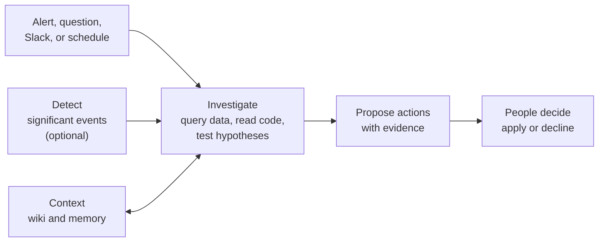

---
applies_to:
  serverless:
    observability: preview
description: Learn what Elastic nightshift is, why you'd use it, how it works, and where to start.
products:
  - id: observability
  - id: cloud-serverless
---

# {{nightshift}} [nightshift-overview]

{{nightshift}} is an AI SRE available in {{serverless-short}}. When something goes wrong in production, it investigates for you: it queries your logs, metrics, and traces, reads your code if you connect it, tests explanations, and hands you a likely cause with the evidence and proposed actions. You decide what happens next.

It learns your system as it works, and brings that knowledge to every investigation, chat, and detection. It can also watch your data for problems that none of your alerts catch.

**First time here?** [Get started](./get-started.md) takes you from enabling {{nightshift}} to your first investigation in a few steps.

:::{image} ../../images/nightshift-home.png
:alt: The Elastic nightshift home page, with investigations grouped by severity, including High investigations about inventory-api latency and Postgres lock timeouts
:screenshot:
:::

## Why use {{nightshift}} [nightshift-overview-why]

Your system changes with every release, alert rules are written by hand, and knowledge of how it fits together often sits with a few engineers. An experienced SRE who joins your team brings the skills but not that knowledge, and an AI model has the same gap. {{nightshift}} builds that knowledge up as context, so it starts on the problem, not on learning your system.

{{nightshift}} does the first pass of an incident, so you start from a summary instead of a blank dashboard. Investigations work on the data and alerts you already have, without detection turned on: no re-instrumenting, no rewritten rules.

| When… | Without {{nightshift}} | With {{nightshift}} |
| --- | --- | --- |
| An alert fires | You piece together what changed from dashboards and traces. | An automation investigates it. You open the likely cause and evidence. |
| Something is wrong, but no alert fired | Users or a teammate tell you. | Detection groups unusual changes into one significant event. |
| The cause is in the code | You search your repositories for the change. | It reads the relevant code and pull requests in a temporary sandbox, without copying or indexing them. |
| Your team works in Slack | You copy charts and links into the channel. | You mention `@Elastic`, and the results appear in the thread. |
| A problem comes back | Someone has to remember last time. | It starts from what it learned before. |

## How it works [nightshift-overview-how]

:::{image} ../../images/nightshift-how-it-works.svg
:alt: Five triggers start an investigation: an alert, the Investigate button, @Elastic in Slack, an automation, or a significant event. Detection learns Knowledge Indicators from your data and raises significant events. The investigation queries your data, reads code in a sandbox, and tests hypotheses. It reads the Wiki and Memory and writes back what it learns. It ends with a likely cause, evidence, and proposed actions, and you decide whether to apply or decline them.
:width: 100%
:::

1. **Something starts an investigation**: a question, an `@Elastic` mention in Slack, **Investigate** on an alert or significant event, or an automation.
1. **{{nightshift}} investigates.** It queries your data, reads connected code, and tests hypotheses, ranked by confidence. This usually takes up to five minutes.
1. **It uses and builds context.** It reads its Wiki and Memory first, and saves what it learned.
1. **It proposes actions**, with the likely cause, the evidence, and what it could not check.
1. **People decide.** {{nightshift}} never changes your environment. You apply or decline each action. Admins set run limits and can pause detection in [Settings and limits](./settings.md).

Conclusions can be wrong. Before you act, check the reasoning in the hypothesis tree. Refer to [How investigations work](./investigation/index.md#nightshift-investigations-accuracy).

## What it costs [nightshift-overview-cost]

{{nightshift}} is billed by the model tokens it uses, and daily run limits keep spending predictable. Refer to [Cost and models](./cost-and-models.md).

## Availability [nightshift-overview-availability]

{{nightshift}} is in Tech Preview on {{obs-serverless}} projects on the Complete tier, in the default space only. Refer to [Known issues](./known-issues.md).

## Give feedback [nightshift-feedback]

On the {{nightshift}} home page, open the {icon}`boxes_vertical` menu and select **Feedback**.

## Your goal → Start here [nightshift-overview-start]

| I want to… | Start here |
| --- | --- |
| Set up {{nightshift}} and run my first investigation | [Get started](./get-started.md) |
| Ask about any problem, in my own words | [Investigate anything](./use-cases/investigate-anything.md) |
| Ask for help from a Slack channel | [Investigate in Slack](./use-cases/investigate-in-slack.md) |
| Find out why an alert fired | [Investigate your alerts](./use-cases/investigate-alerts.md) |
| Have alerts investigated before I look at them | [Automatically investigate your alerts](./use-cases/auto-investigate-alerts.md) with [automations](./investigation/automations.md) |
| Find problems that none of my alerts catch | [Detect problems automatically](./use-cases/detect-problems.md) with [detection](./detection/index.md), an optional add-on |
| Read an investigation and check its reasoning | [How investigations work](./investigation/index.md) |
| Review or correct what {{nightshift}} learned | [Context](./context/index.md): the Wiki, Memory, and Knowledge Indicators |
| Find out what it costs and how my data is used | [Cost and models](./cost-and-models.md) |
| Check what works with my deployment (Serverless, ECH, self-managed) | [Reference architecture](./reference-architecture.md) |
