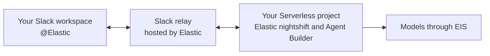

# Elastic app for Slack [nightshift-slack-app]

The Elastic app for Slack brings {{nightshift}} into your Slack workspace as the `@Elastic` bot. Your team can mention `@Elastic` to ask questions, automations can post investigation results to a channel, and alerts that other tools post in Slack can start investigations.

This page is for Slack admins, {{nightshift}} admins, and security reviewers. It explains what the app can access, the Slack permissions it requests, how it behaves in each kind of conversation, and what happens to your Slack data. To set it up, refer to [Set up Slack](./investigation/set-up.md#nightshift-set-up-slack). To use it, refer to [Investigate in Slack](./use-cases/investigate-in-slack.md).

## How it works [nightshift-slack-app-how]

Slack delivers all of an app's events to a single URL, so Elastic hosts a service called the Slack relay between Slack and your project. The relay verifies that each event comes from Slack, finds the {{nightshift}} project that the channel is connected to, forwards the event, and posts the reply back to the thread.

- **One app, many projects.** One installation of the app serves the whole Slack workspace. Several Elastic projects, such as production and staging, can connect to the same workspace. Each channel connects to exactly one project.
- **Admins choose the channels.** `@Elastic` answers only in channels that a {{nightshift}} admin has connected to a project in {{kib}}. Inviting `@Elastic` to a channel isn't enough.
- **Your project keeps the record.** Conversations, investigations, and their findings are stored in your project. The relay doesn't keep message content. Refer to [Where your Slack data goes](#nightshift-slack-app-data).

## Who sets it up [nightshift-slack-app-roles]

| Role | What they do |
| --- | --- |
| Slack admin | Approves the Elastic app, if your workspace requires approval, and chooses whether to allow private channel access. |
| {{nightshift}} admin | Connects the Slack workspace to the project, then connects each channel. Needs **Nightshift**: **All** and **Manage engines**. Refer to [Grant access](./privileges.md). Without **Manage engines**, {{kib}} shows the Slack settings but you can't change them. |
| Channel member | Invites `@Elastic` to the channel, for example with `/invite @Elastic`. |

## Who `@Elastic` acts as [nightshift-slack-app-identity]

`@Elastic` doesn't act as the person who mentions it. Slack users aren't matched to Elastic users, and they don't need an Elastic account. Every answer in Slack comes from what the {{nightshift}} service accounts and the connectors in the space can reach. Refer to [Privileges that {{nightshift}} runs with](./privileges.md#nightshift-privileges-accounts).

As a result, everyone in a connected channel can read what {{nightshift}} can read, including guests and people who were added to the channel later. Connect only the channels whose members should see that data. If only certain people should see some data, put that data in a separate project with its own {{nightshift}} setup.

When an admin connects Slack, {{kib}} creates a service account for the Slack connection, named `nightshift-relay-agent-builder-<ID>`. The relay uses the account for two calls to your project: passing each mention to the {{nightshift}} agent, and forwarding messages from connected public channels so that automations can match them. The agent runs as the `nightshift_agent` account, so the Slack connection doesn't change what an answer can read.

Only the relay can use the account. For every call, it exchanges the account ID for a token that expires after a few minutes, so no long-lived key is stored. When you disconnect the workspace, {{kib}} deletes the account.

The Slack connection account is also capped by the privileges that the connecting admin had when they connected Slack. If that admin couldn't chat with the {{nightshift}} agent in **Agent Builder**, mentions in Slack are refused and `@Elastic` replies with an error instead of an answer. To fix it, have an admin with **Agent Builder**: **All** disconnect the workspace and connect it again.

## How `@Elastic` behaves in Slack [nightshift-slack-app-behavior]

| Where | What happens |
| --- | --- |
| A connected public channel | A mention of `@Elastic` gets a threaded answer, with a **View in {{kib}}** link to the conversation. Follow-up mentions in the thread continue the same conversation. Messages that other apps post can start investigations through an automation with the **New message in channel** trigger. |
| A connected private channel | A mention of `@Elastic` gets a threaded answer, as in a public channel. Messages in private channels can't trigger automations, and investigations can't read the channel's history. An admin must allow private channel access first. Refer to [Private channels](#nightshift-slack-app-private). |
| A channel that isn't connected | When `@Elastic` joins, it posts the channel ID and asks you to have an Elastic admin connect the channel. It gives the same reply to a mention instead of answering, at most once every 10 minutes per channel. |
| A direct message to `@Elastic` | Not supported. `@Elastic` replies that direct messages aren't supported, at most once an hour per person. |
| A Slack Connect channel shared with another organization | Not supported in Tech Preview. Messages from the other organization are never sent to your project, and investigations can't read a shared channel. |

When a channel is connected, `@Elastic` posts a message there saying that the project is connected and ready.

While it works on an answer, `@Elastic` shows a plan in the thread titled **Rolling up my sleeves**, with a row for each step that it runs. The answer appears under the plan when it's done, and the plan's title changes to **Finished N steps**, or **Done** when no steps ran. If it can't answer, `@Elastic` posts the reason in the thread. Refer to [Troubleshoot `@Elastic` responses](#nightshift-slack-app-notices).

`@Elastic` answers people. When another app posts a message that mentions `@Elastic`, it doesn't answer, but that message can start an automation.

Editing a message never changes an answer that `@Elastic` already gave. Edits and deletions in a connected public channel are still sent to your project, like any other message. Refer to [What `@Elastic` reads from Slack](#nightshift-slack-app-reads).

A mention that opens a new conversation counts toward the **Manual investigations daily limit**. When the limit is reached, `@Elastic` replies that an admin can raise it. Follow-up mentions in the same thread aren't counted. Refer to [Investigation limits](./investigation/limits.md).

### Troubleshoot `@Elastic` responses [nightshift-slack-app-notices]

The following table lists the messages that `@Elastic` posts when it can't answer your question, and what to do. If your project rejects a request for another reason, `@Elastic` posts the project's explanation without changing it.

| Where or when | The message `@Elastic` posts | What to do |
| --- | --- | --- |
| You mention it in a channel that isn't connected | This channel isn't connected yet. Ask your Elastic admin to connect it in Kibana Settings using channel ID `C0123456789`, then mention me again. | Send the channel ID to your admin. `@Elastic` posts this at most once every 10 minutes per channel, so later mentions in that window get no reply. |
| You open its **Messages** tab | Direct messages aren't supported yet. Mention me in a channel that's connected to Kibana instead. | Mention it in a connected channel. `@Elastic` posts this at most once an hour, and Slack doesn't let you type a message to the app. |
| You mention it while it's still answering in the same thread | Elastic is still answering an earlier message in this thread. Please ask again once that reply is posted. | `@Elastic` waits up to two minutes for the earlier answer before it posts this. Ask again once the answer is posted. |
| Your project can't be reached, or refuses the request | Sorry, I couldn't reach Elastic right now. Please try again in a few minutes. | `@Elastic` retries for about two minutes before it posts this. Try again later. If it keeps happening, ask your admin to check the Slack connection. Refer to [Who `@Elastic` acts as](#nightshift-slack-app-identity). |
| The Slack connection needs to be set up again | Your Elastic connection has expired. Please reconnect it in Kibana and try again. | Ask your {{nightshift}} admin to disconnect and connect the workspace again. |
| A daily limit is reached | The daily limit of 5 for manual investigations has been reached. An admin can raise it in nightshift settings. The number is your project's limit, and the message names the limit that was reached. | Ask your {{nightshift}} admin. Refer to [Investigation limits](./investigation/limits.md). |
| The answer fails or stops | Elastic response failed., Elastic could not finish this turn., or Elastic stopped working on this request., under a plan titled **Stopped**, with a **View in {{kib}}** link | Open the conversation in {{kib}}, or ask again. |
| The agent finishes without an answer | Elastic completed without a response. | Open the conversation in {{kib}}, or ask again. |
| Slack rejects the answer | Couldn't post the answer here - Slack rejected the message. Open this conversation in Kibana to read it. | Open the conversation in {{kib}}. |
| The agent needs more input | Elastic needs more information to continue. Open the conversation in Kibana to answer. | Answer in {{kib}}. |
| The answer is longer than Slack allows | The answer, ending with: _Response truncated. Open the conversation in Kibana for the full answer._ | Select **View in {{kib}}**. |

When your project refuses your message, for example because the daily limit is reached, or `@Elastic` can't get it there at all, `@Elastic` also adds a `:warning:` reaction to your message, so you can spot it in a busy channel. An answer that fails after it started gets no reaction.

## Private channels [nightshift-slack-app-private]

Private channel access is optional. The person who connects Slack, or the Slack admin who approves the app, can allow or decline it. This choice applies to the whole Slack workspace and every Elastic project connected to it. `@Elastic` still sees only the private channels that someone invites it to.

If you connected Slack without private channel access and want to turn it on, disconnect the workspace in {{kib}}, connect it again, and allow private channel access. Then connect your channels again. To connect a private channel, invite `@Elastic` to it in Slack, then enter its channel ID or link in **Connect a channel**. Private channels aren't listed in the **Channel** list.

To turn private channel access off, remove the app from the workspace in Slack, then reinstall it and decline private channel access. Slack doesn't remove permissions from an existing installation.

## Slack permissions [nightshift-slack-app-scopes]

Slack shows these permissions when you install the app. `@Elastic` uses them only in channels that it has been invited to, and it can't read channels that it isn't a member of. Content from a channel reaches your project only when the channel is connected to it.

| Permission | Required | What `@Elastic` uses it for |
| --- | --- | --- |
| `app_mentions:read` | Yes | Receive messages that mention `@Elastic`. |
| `assistant:write` | Yes | Show its progress in the thread while it works on an answer. |
| `channels:history` | Yes | Read the thread that a mention is in, receive messages in connected public channels for automations, and let investigations read recent messages in a connected public channel. |
| `channels:read` | Yes | List the public channels it has been invited to, so admins can pick one in {{kib}}. Check that it's a member of a channel before an admin connects it. |
| `chat:write` | Yes | Post and update answers, investigation status, and results in threads. |
| `im:history` | Yes | Receive direct messages, only so that it can reply that they aren't supported. |
| `reactions:write` | Yes | Add a `:warning:` reaction when your project refuses a message or can't be reached. |
| `users:read` | Yes | Show people's display names instead of Slack user IDs in the context that it sends to your project. It doesn't read email addresses. |
| `groups:history` | No | In private channels that it's invited to, read the thread that a mention is in. |
| `groups:read` | No | Check that it's a member of a private channel before an admin connects it. |

The app also subscribes to these Slack events: `app_mention`, `message.channels`, `message.groups`, `message.im`, `member_joined_channel`, `app_home_opened`, and `app_uninstalled`. Slack sends `message.groups` only when private channel access is allowed. The relay drops private channel messages that don't mention `@Elastic`.

## What `@Elastic` reads from Slack [nightshift-slack-app-reads]

**When you mention `@Elastic`**
:   Your message. In a thread, the relay also reads the thread's first message and up to four of the latest messages from other people since `@Elastic` last posted there. In a long thread, it may read only the first message. Each message is capped at 2,000 characters. The relay reads the thread again for every mention and doesn't keep it.

**In connected public channels**
:   Every message event, so that automations with the **New message in channel** trigger can match them, for example alerts that another app posts. This includes edits and deletions, and a deletion can include the deleted text. An automation that matches a message receives its text, up to 4,000 characters. Replies in an investigation's thread are added to that investigation, even without a mention. Refer to [Discuss an investigation in its thread](./use-cases/investigate-in-slack.md#nightshift-uc-slack-discuss).

**During an investigation**
:   An investigation can read recent messages in a connected public channel that `@Elastic` is a member of. By default it reads the last two hours, up to seven days. It can't read private channels, shared channels, direct messages, or channels that aren't connected to the project.

**People's names**
:   The display names of the people in the thread, so that answers and the investigation record show who said what. Names are held in memory for up to six hours and aren't written to disk.

**What it doesn't read**
:   Channels that `@Elastic` isn't a member of, the content of direct messages, and files.

## Where your Slack data goes [nightshift-slack-app-data]

| Where | What's kept | How long |
| --- | --- | --- |
| The Slack relay | The workspace installation and its Slack bot token, which channels connect to which project, the channel names, the project's {{kib}} URL, and the ID of each project's Slack connection service account. The token and the account ID are encrypted. No message content. | Until the channel or workspace is disconnected, or the app is removed from Slack. |
| The Slack relay, in transit | Slack events that are waiting to be delivered to your project, encrypted. | Deleted when your project accepts the event, or within an hour if it can't be delivered. |
| The Slack relay, per answer | IDs and state for an answer in progress, such as which message to update. No message content. | Up to one hour. |
| Your project | Conversations, investigations, and the Slack messages that they include, with the names of the people who wrote them. | Until you delete them. Refer to [Deleting data](./cost-and-models.md#nightshift-data). |
| Your project, the `.workflows-events` data stream | Every message in a connected public channel, with its text, including messages that no automation matches. {{nightshift}} itself doesn't keep them. Workflows logs them as trigger events. | No retention period is set on the data stream. |
| Models through EIS | The Slack messages in a thread are sent to the model along with the rest of the investigation. | Refer to [What it sends to models](./cost-and-models.md#nightshift-data). |
| Slack | The messages that `@Elastic` posts. | Your Slack workspace's retention settings. |

The relay runs in a single AWS region, `us-east-1`, during Tech Preview. Slack events for every project pass through it, whatever region the project is in. If your organization requires Slack data to stay in a specific region, check whether this meets your requirements before you connect Slack.

For how Elastic processes personal data, including the Data Processing Addendum and GDPR, refer to the [Elastic Trust Center](https://www.elastic.co/trust).

## Disconnect or remove the app [nightshift-slack-app-disconnect]

**Disconnect a channel**
:   On the {{nightshift}} **Settings** page, select **Disconnect channel** next to the channel. `@Elastic` stops answering there and replies that the channel isn't connected. It stays in the channel until you remove it in Slack. Automations that post to the channel stop posting.

**Disconnect the workspace**
:   On the {{nightshift}} **Settings** page from the **Slack channels** section, open the {icon}boxes_vertical menu and select **Disconnect workspace**. This disconnects every channel for this project. Other Elastic projects connected to the same workspace aren't affected. When the last project disconnects, the relay revokes the bot token and deletes the installation.

**Remove the app from Slack**
:   When a Slack admin removes the app from the workspace, the relay deletes the installation and every channel connection for every project connected to the workspace.

Disconnecting doesn't delete conversations or investigations from your project, or the messages that `@Elastic` already posted in Slack.

## Learn more [nightshift-slack-app-next]

- [Set up Slack](./investigation/set-up.md#nightshift-set-up-slack): Connect the workspace and your channels.
- [Investigate in Slack](./use-cases/investigate-in-slack.md): Ask `@Elastic` for help and follow up in a thread.
- [Investigate alerts from your other tools](./use-cases/external-alerts.md): Start investigations from alerts that other apps post in Slack.
- [Grant access](./privileges.md): Find out which privileges {{nightshift}} runs with.
- [Your data and {{nightshift}}](./cost-and-models.md#nightshift-data): Find out what {{nightshift}} sends to models and stores.
