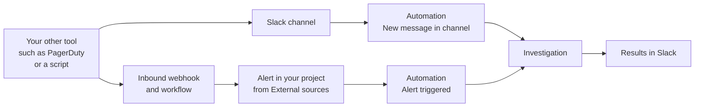

# Investigate alerts from your other tools [nightshift-uc-external-alerts]

Have alerts from your other tools investigated automatically, without recreating their rules in Elastic. When another monitoring tool, an {{ech}} deployment, PagerDuty, or a script raises an alert, an automation starts a {{nightshift}} investigation and posts the likely cause and proposed actions in Slack.

There are two routes. If the tool already posts its alerts to a Slack channel, an automation watches that channel and replies in the alert's thread. If it can send a webhook, a workflow turns each request into an alert in your project, and an automation investigates it.



1. Your other tool raises an alert and sends it to Slack or to a webhook.
1. **Slack route:** The tool's message arrives in a connected channel. An automation with the **New message in channel** trigger matches messages from that tool's app.
1. **Webhook route:** The tool sends the alert to an inbound webhook URL. A workflow creates an alert in your project, and an automation with the **Alert triggered** trigger matches alerts from **External sources**.
1. The automation checks its limits and starts an investigation.
1. {{nightshift}} posts the results in Slack: in the thread of the alert message for the Slack route, or in the channel that you choose for the webhook route.

## Example: Alertmanager alerts in Slack [nightshift-uc-ext-example]

Your Kubernetes clusters run Prometheus, and Alertmanager posts firing alerts to `#checkout-alerts` as an app called `Alertmanager`. The logs and traces for `web` and `inventory-api` are in your Elastic project.

At 02:10 UTC, Alertmanager posts `[FIRING:1] HighLatency inventory-api` to the channel. A minute later, {{nightshift}} replies in that message's thread to say that it's investigating. A few minutes later, it replies there again with the impact, the conclusion, and the hypotheses it tested.

## Choose a route [nightshift-uc-ext-choose]

| | Slack route | Webhook route |
| --- | --- | --- |
| **Use it when** | The tool already posts its alerts to a Slack channel. | The tool can send an HTTP request, but doesn't post to Slack. |
| **Setup** | One automation. | An inbound webhook connector, a workflow, and an automation. |
| **Where results go** | The thread of the alert message. | A connected Slack channel that you choose. |

Start with the Slack route if you can. It needs the least setup, and the results land next to the alert, where your team already looks.

## Before you begin [nightshift-uc-ext-before]

- An admin has [enabled {{nightshift}}](../get-started/investigations.md#nightshift-get-started-enable).
- You have the privileges to create automations. Refer to [Grant access](../get-started/privileges.md#nightshift-privileges-admin).
- {{nightshift}} can query the data behind the alerts. If the alerts come from an {{ech}} deployment or another cluster, add an External {{es}} connector for it. Refer to [Reference architecture](../reference-architecture.md#nightshift-reference-architecture-ech).
- To post to Slack, an admin has connected the Slack workspace and the channel. Refer to [Slack](../investigation/set-up.md#nightshift-set-up-slack).

## Investigate alerts that your tool posts in Slack [nightshift-uc-ext-slack]

Use this route when the tool already posts its alerts to a Slack channel. In this example, the app is `Alertmanager` and the channel is `#checkout-alerts`.

1. Find the app's exact name, app ID, or bot ID. In Slack, select the app's name on one of its alert messages to open its profile.
1. On the {{nightshift}} home page, select **Automations**, then select **Create automation**.
1. Enter a **Name**, for example `Investigate Alertmanager alerts in #checkout-alerts`.
1. Under **Trigger**, select **Add trigger**, then **New message in channel**.

   :::{image} ../../../images/nightshift-automation-create-trigger.png
   :alt: The Create automation flyout with the Add trigger menu open, where New message in channel is listed under Slack
   :screenshot:
   :::

1. In **Select channels**, select `#checkout-alerts`.
1. Select **Any app**, and enter the app's exact name, app ID, or bot ID, for example `Alertmanager`. Messages from people and from other apps in the channel no longer start the automation.

   % SCREENSHOT: Create automation flyout, New message in channel trigger with #checkout-alerts selected, Any app set to "Alertmanager", and Message contains… set to "FIRING".

1. Optionally, select **Any message** and enter text in **Message contains…** to match only some messages, for example `FIRING`. The match is case-sensitive, and it includes text in the message's attachments and blocks.
1. Set the **Daily trigger limit**, and describe the tool and its messages in **Additional Instructions**. Refer to [Limits that apply](#nightshift-uc-ext-limits) and [Tell {{nightshift}} about your tool](#nightshift-uc-ext-instructions).
1. Check **Actions**. With a Slack trigger, the **Post in Slack** action is added for you and shows "Nightshift replies in the thread of the triggering message."
1. Select **Save and enable**.

The automation appears on the **Automations** page with **Enabled** on. When the app posts its next alert, {{nightshift}} replies in that message's thread.

:::{image} ../../../images/nightshift-slack-thread.png
:alt: A Slack thread under a critical alert message from an alerting app. @Elastic replies in the thread with Impact and Conclusion sections, followed by Hypotheses
:screenshot:
:::

Only top-level messages start the automation. Thread replies don't, and neither do edits, so a tool that updates its original message when the alert resolves doesn't start a second investigation. A tool that posts a separate message when the alert resolves does, unless **Message contains…** filters it out.

Anyone in the channel can ask follow-up questions in the thread. Refer to [Investigate in Slack](./investigate-in-slack.md).

## Send alerts to {{nightshift}} with a webhook [nightshift-uc-ext-webhook]

Use this route when the tool can send an HTTP request, but doesn't post to Slack. For example, a custom script, a tool with a generic webhook notification, or a rule in an {{ech}} deployment with a webhook action.

The tool sends each alert to an **Inbound Webhook** connector in your {{nightshift}} project. A workflow that listens to the connector creates an alert in the project with the **Create Alert** step. An automation with the **Alert triggered** trigger then investigates the alert, as it does for alerts from your own rules.

### Create the webhook and the workflow [nightshift-uc-ext-webhook-workflow]

1. In **Stack Management** > **Connectors**, create an **Inbound Webhook** connector. Copy its ingest URL and token. The URL has the form `https://<your-kibana-url>/api/actions/events/.inboundWebhook/<connector-id>`.
1. On the **Workflows** page, create a workflow that the connector triggers, with a **Create Alert** step. Map the fields from your tool's request into the alert. For example:

   ```yaml
   name: Import alerts from the monitoring bot
   enabled: true
   triggers:
     - type: inboundWebhook.received
       connector-id: <connector-id>
   steps:
     - name: create_external_alert
       type: alerting.create_alert
       with:
         source: "monitoring-bot"
         fingerprint: "{{ event.body.id }}"
         alert_status: "{{ event.body.status | default: 'active' }}"
         severity: "high"
         data:
           rule_name: "{{ event.body.title }}"
           service: "{{ event.body.service }}"
           message: "{{ event.body.summary }}"
           source_alert_url: "{{ event.body.url }}"
   ```

1. Configure your tool to send each alert as a JSON `POST` request to the ingest URL, with the header `Authorization: Bearer <token>`. To test it:

   ```sh
   curl -X POST "https://<your-kibana-url>/api/actions/events/.inboundWebhook/<connector-id>" \
     -H "Authorization: Bearer <token>" \
     -H "Content-Type: application/json" \
     -d '{"id":"alert-123","status":"active","title":"High latency","service":"checkout","summary":"p95 latency above 2 s for 10 minutes","url":"https://monitoring.example.com/alerts/123"}'
   ```

   A successful request returns `202`. The workflow run appears in the workflow's executions, and the alert appears in your project's alerts.

Keep these rules in mind when you map the fields:

- **`source`** names your tool. It can't start with `elastic`. Any other value counts as an **External sources** alert in {{nightshift}}.
- **`fingerprint`** identifies the alert. Use a value that stays the same while the alert is open, such as the tool's alert ID. A request with the same fingerprint for an open alert doesn't start a second investigation.
- **`alert_status`** is `active` for a firing alert. To close the alert, send `inactive` in the `status` field with the same fingerprint.
- **`severity`** is one of `info`, `low`, `medium`, `high`, or `critical`.
- **`data`** holds what the investigation needs: the alert title, the service, a short message, and a link back to the tool.

The ingest token is a secret. Anyone who has it can create alerts and start investigations in your project. Store it in your tool's secret store, and rely on the automation's daily trigger limit as a guardrail.

For more about workflows, refer to [Workflows](/explore-analyze/workflows.md).

### Create the automation [nightshift-uc-ext-webhook-automation]

1. On the {{nightshift}} home page, select **Automations**, then select **Create automation**.
1. Enter a **Name**, for example `Investigate monitoring bot alerts`.
1. Under **Trigger**, select **Add trigger**, then **Alert triggered**.
1. Select **any source**, select **Only these sources**, then select **External sources**.
1. Leave **Any rule** as it is. Alerts from the webhook have no rule, so a rule or tag filter never matches them.
1. Optionally, select **Any severity** to match only some severities, for example **Critical**.
1. Set the **Daily trigger limit**, and describe the tool and its alerts in **Additional Instructions**. Refer to [Limits that apply](#nightshift-uc-ext-limits) and [Tell {{nightshift}} about your tool](#nightshift-uc-ext-instructions).
1. Under **Actions**, select **Add action**, then **Post in Slack**, and select a connected channel.
1. Select **Save and enable**.

The automation appears on the **Automations** page with **Enabled** on. Send a test request, then check the automation's **Run history**. Refer to [Check what an automation did](../investigation/automations.md#nightshift-automations-run-history).

% SCREENSHOT: Create automation flyout, Alert triggered trigger with the source picker open, Only these sources selected, and External sources checked.

## Tell {{nightshift}} about your tool [nightshift-uc-ext-instructions]

An investigation started this way has only the alert to start from. For the Slack route, it receives the message text, up to 4,000 characters. Use **Additional Instructions**, up to 5,000 characters, to connect the alert to your data in Elastic:

- **What the tool is**: the tool's name, what it monitors, and how reliable its alerts are.
- **How its alerts look**: where the alert name, the service, the severity, and the time are in the message or payload, and what the labels mean.
- **How names map to Elastic data**: which service names in the alert match which `service.name` values, indices, or data views, and which data is in a separate {{ech}} deployment.
- **Where to look first**: runbooks, dashboards, and the GitHub repositories for the services.

For the Alertmanager example:

```text
Alerts come from Prometheus Alertmanager for the checkout Kubernetes cluster.
Message format: "[FIRING:<n>] <alertname> <service>", then labels:
severity, namespace, pod, and a "summary" annotation.
The "service" label matches service.name in logs-* and traces-*:
  inventory-api -> inventory-api, checkout-web -> web.
The namespace label matches kubernetes.namespace in metrics-*.
inventory-api uses the Postgres database encore. Runbook:
https://wiki.example.com/runbooks/checkout. Code: github.com/example/inventory-api.
```

To give this context to every investigation, not only this automation's, add it as custom context in **Settings**. Refer to [Extend investigations](../investigation/extend.md#nightshift-extend-custom-context).

## Limits that apply [nightshift-uc-ext-limits]

Both routes start automatic investigations, so the automation's **Daily trigger limit** and the deployment-wide limits apply. A noisy tool can use up the shared limit for every automation, so match only the alerts that you want investigated. Refer to [Investigation limits](../investigation/limits.md).

## Tips [nightshift-uc-ext-tips]

- **Start with one tool and one channel.** Check the first results, then improve the instructions where {{nightshift}} looked in the wrong place.
- **Filter out resolved messages.** If the tool posts a separate message when an alert resolves, set **Message contains…** to text that only firing alerts have.

## Next steps [nightshift-uc-ext-next]

- [Automatically investigate your alerts](./auto-investigate-alerts.md): Investigate alerts from rules in your {{nightshift}} project.
- [Investigate in Slack](./investigate-in-slack.md): Ask follow-up questions in the results thread.
- [Automations](../investigation/automations.md): Read every trigger option and setting.
- [Reference architecture](../reference-architecture.md): Check how {{nightshift}} reaches data in other deployments.
