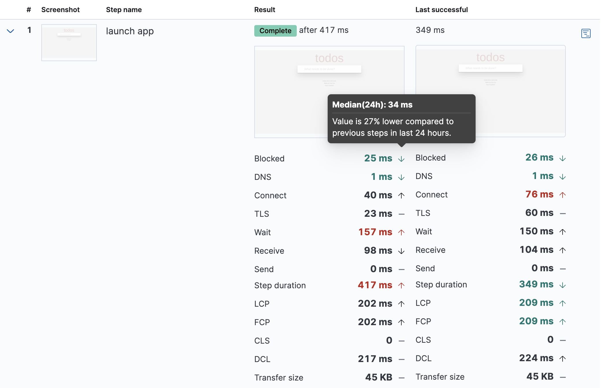

# Analyze data from synthetic monitors

The Synthetics UI gives you a high-level overview of your service’s availability and allows you to dig into details to diagnose what caused downtime. You can view monitor data from the current cluster or {{serverless-short}} project, as well as from [remote clusters](/solutions/observability/synthetics/analyze-data.md#synthetics-analyze-remote-monitors) or [linked projects](/solutions/observability/synthetics/analyze-data.md#synthetics-analyze-linked-monitors).

## Overview [synthetics-analyze-overview]

The Synthetics **Overview** tab provides you with a high-level view of all the services you are monitoring to help you quickly diagnose outages and other connectivity issues within your network.

To access this page, find `Synthetics` in the [global search field](/explore-analyze/find-and-organize/find-apps-and-objects.md) and make sure you’re on the **Overview** tab.

This overview includes a snapshot of the current status of all monitors, plus:

* {applies_to}`stack: ga 9.6+` {applies_to}`serverless: ga` A **Pings over time** chart covering the time range you select.
* {applies_to}`stack: ga =9.5` Separate **Errors** and **Alerts** panels covering the time range you select.
* {applies_to}`stack: ga 9.0-9.4` The number of errors that occurred over the last 6 hours, and the number of alerts over the last 12 hours.

All monitors created using projects or using the UI are listed with information about the location, current status, and duration average.

::::{note}
When you use a single monitor configuration to create monitors in multiple locations, each location is listed as a separate monitor as they run as individual monitors and the status and duration average can vary by location.

::::

:::{image} /solutions/images/observability-synthetics-monitor-page.png
:alt: Synthetics Overview in 9.6 with the Monitors status panel, Pings over time chart, and monitor grid
:screenshot:
:::

The screenshot shows {{stack}} 9.6.

To get started with your analysis in the **Overview** tab, you can search for monitors or use the filter options including current status (up, down, or disabled), monitor type (for example, journey or HTTP), location, and more.

Then click an individual monitor to see some details in a flyout. From there, click **Go to monitor** to open that monitor’s page.

### Monitors status and pings over time [synthetics-analyze-overview-activity]
```{applies_to}
stack: ga 9.6+
serverless: ga
```

The **Monitors status** and **Pings over time** panels on the **Overview** tab summarize the monitors that match your current search, filters, and time range.

The **Monitors status** panel counts the monitors in each state: **Up**, **Down**, **Disabled**, **Pending**, and **Stale**. Select a state to filter the page to it, and select it again to clear the filter. To show the states as a donut chart rather than a grid of counts, click {icon}`chart_pie` **Show status as donut chart**.

The **Alerts** count shows the number of active and recovered alerts that started during the selected time range. A monitor can contribute more than one alert to this count. Click **Alerts** to open the **Alerts** page with the same monitor filters and time range.

The **Pings over time** chart stacks the **Up** and **Down** ping counts over the time range you select, with an **Error states** line over the top. Each alert appears as an **Alert** marker at the time the alert started. Hover over a marker to see the monitor, the reason for the alert, and the alert's duration.

To zoom in on part of the chart, drag to select a range. The rest of the page follows: the time picker, both panels, and the monitor list all update to the range you selected.

## All monitor types [synthetics-analyze-individual-monitors]

When you open an individual monitor’s page, you see much more detail about the monitor’s performance over time. The details vary by monitor type, but for every monitor at the top of the page you see:

* The monitor’s **name** with a down arrow icon that you can use to quickly move between monitors.
* The **location** of the monitor. If the same monitor configuration was used to create monitors in multiple locations, you also see a down arrow icon that you can use to quickly move between locations that use the same configuration.
* The latest **status** and when the monitor was **last run**.
* The ** Run test manually** button that allows you to run the test on demand before the next scheduled run.

    ::::{note}
    This is only available for monitors running on Elastic’s global managed testing infrastructure. It is not available for monitors running on {{private-location}}s.

    ::::

* The ** Edit monitor** button that allows you to edit the monitor’s configuration.

:::{image} /solutions/images/observability-synthetics-analyze-individual-monitor-header.png
:alt: Header at the top of the individual monitor page for all monitor types in the {{synthetics-app}}
:screenshot:
:::

Each individual monitor’s page has three tabs: Overview, History, and Errors.

:::{note}
:applies_to: {"stack": "ga 9.4+"}

The AI Agent has access to monitor configuration (name, type, schedule, locations, and tags) on all monitor detail tabs. Refer to [Synthetics monitor context](/solutions/observability/ai/agent-builder-observability.md#synthetics-monitor-context) for more information.
:::

### Overview [synthetics-analyze-individual-monitors-overview]

The **Overview** tab has information about the monitor availability, duration, and any errors that have occurred since the monitor was created. The *Duration trends* chart displays the timing for each check that was performed in the last 30 days. This visualization helps you to gain insights into how quickly requests resolve by the targeted endpoint and gives you a sense of how frequently a host or endpoint was down.

:::{image} /solutions/images/observability-synthetics-analyze-individual-monitor-details.png
:alt: Details in the Overview tab on the individual monitor page for all monitor types in the {{synthetics-app}}
:screenshot:
:::

{applies_to}`stack: ga 9.6+` {applies_to}`serverless: ga` For monitors that run on {{private-location}}s, the **Monitor details** panel also shows which {{agents}} run the monitor. If all the monitor's {{private-location}}s are [scalable](/solutions/observability/synthetics/monitor-resources-on-private-networks.md#synthetics-private-location-scalable), the panel shows the **Assigned agent** that runs the monitor, or **Not yet assigned** if Synthetics hasn't assigned an agent yet. Otherwise, it shows the **Location agents**, which are all the agents enrolled on the location's agent policy.

### History [synthetics-analyze-individual-monitors-history]

The **History** tab has information on every time the monitor has run. It includes some high-level stats and a complete list of all test runs. Use the calendar icon () and search bar to filter for runs that occurred in a specific time period.

For browser monitors, you can click on any run in the **Test runs** list to see the details for that run. Read more about that information in [Details for one run](/solutions/observability/synthetics/analyze-data.md#synthetics-analyze-one-run).

:::{image} /solutions/images/observability-synthetics-analyze-individual-monitor-history.png
:alt: The History tab on the individual monitor page for all monitor types in the {{synthetics-app}}
:screenshot:
:::

If the monitor is configured to [retest on failure](/solutions/observability/synthetics/configure-projects.md#synthetics-configuration-monitor), you see retests listed in the **Test runs** table. Runs that are retests include a rerun icon () next to the result badge.

:::{image} /solutions/images/observability-synthetics-retest.png
:alt: A failed run and a retest in the table of test runs in the {{synthetics-app}}
:screenshot:
:::

### Errors [synthetics-analyze-individual-monitors-errors]

The **Errors** tab has information on failed runs. If the monitor is configured to [retest on failure](/solutions/observability/synthetics/configure-projects.md#synthetics-configuration-monitor), a failed run results in an error only if both the initial run and the rerun fail. This can reduce noise related to transient problems.

The Errors tab includes a high-level overview of all alerts and a complete list of all failures. Use the calendar icon () and search bar to filter for runs that occurred in a specific time period.

For browser monitors, you can click on any run in the **Error** list to open an **Error details** page that includes most of the same information as [Details for one run](/solutions/observability/synthetics/analyze-data.md#synthetics-analyze-one-run).

:::{image} /solutions/images/observability-synthetics-analyze-individual-monitor-errors.png
:alt: The Errors tab on the individual monitor page for all monitor types in the {{synthetics-app}}
:screenshot:
:::

## Browser monitors [synthetics-analyze-journeys]

For browser monitors, you can look at results at various levels of granularity:

* See an overview of journey runs over time.
* Drill down into the details of a single run.
* Drill down further into the details of a single *step* within a journey.

### Journey runs over time [journey_runs_over_time]

The journey page on the Overview tab includes:

* An overview of the **last test run** including high-level information for each step.
* **Alerts** to date including both active and recovered alerts.
* **Duration by step** over the last 24 hours.
* A list of the **last 10 test runs** that link to the [details for each run](/solutions/observability/synthetics/analyze-data.md#synthetics-analyze-one-run).

:::{image} /solutions/images/observability-synthetics-analyze-journeys-over-time.png
:alt: Individual journey page for browser monitors in the {{synthetics-app}}
:screenshot:
:::

From here, you can either drill down into:

* The latest run of the full journey by clicking ** View test run** or a past run in the list of **Last 10 test runs**. This opens [Details for one run](/solutions/observability/synthetics/analyze-data.md#synthetics-analyze-one-run).
* An individual step in this run by clicking the performance breakdown icon () next to one of the steps. This opens [Details for one step](/solutions/observability/synthetics/analyze-data.md#synthetics-analyze-one-step).

### Details for one run [synthetics-analyze-one-run]

The page detailing one run for a journey includes more information on each step in the current run and opportunities to compare each step to the same step in previous runs.

At the top of the page, see the *Code executed* and any *Console* output for each step. If the step failed, this also includes a *Stacktrace* tab that you can use to diagnose the cause of errors.

Navigate through each step using ** Previous** and **Next **.

:::{image} /solutions/images/observability-synthetics-analyze-one-run-code-executed.png
:alt: Step carousel on a page detailing one run of a browser monitor in the {{synthetics-app}}
:screenshot:
:::

Open the steps in this journey run. Click the  icon next to the step number to show details. The details include metrics for the step in the current run and the step in the last successful run. Read more about step-level metrics in [Timing](/solutions/observability/synthetics/analyze-data.md#synthetics-analyze-one-step-timing) and [Metrics](/solutions/observability/synthetics/analyze-data.md#synthetics-analyze-one-step-metrics).

This is particularly useful to compare the metrics for a failed step to the last time it completed successfully when trying to diagnose the reason it failed.



Drill down to see even more details for an individual step by clicking the performance breakdown icon () next to one of the steps. This opens [Details for one step](/solutions/observability/synthetics/analyze-data.md#synthetics-analyze-one-step).

### Details for one step [synthetics-analyze-one-step]

After clicking the performance breakdown icon () you see more detail for an individual step.

#### Screenshot [synthetics-analyze-one-step-screenshot]

By default the synthetics library captures a screenshot for each step regardless of whether the step completed or failed.

::::{note}
Customize screenshot behavior for all monitors in the [configuration file](/solutions/observability/synthetics/configure-projects.md), for one monitor using [`monitor.use`](/solutions/observability/synthetics/configure-individual-browser-monitors.md), or for a run using the [CLI](/solutions/observability/synthetics/cli.md#elastic-synthetics-command).

::::

Screenshots can be particularly helpful to identify what went wrong when a step fails because of a change to the UI. You can compare the failed step to the last time the step successfully completed.

:::{image} /solutions/images/observability-synthetics-analyze-one-step-screenshot.png
:alt: Screenshot for one step in a browser monitor in the {{synthetics-app}}
:screenshot:
:::

#### Timing [synthetics-analyze-one-step-timing]

The **Timing** visualization shows a breakdown of the time spent in each part of the resource loading process for the step including:

* **Blocked**: The request was initiated but is blocked or queued.
* **DNS**: The DNS lookup to convert the hostname to an IP Address.
* **Connect**: The time it took the request to connect to the server. Lengthy connections could indicate network issues, connection errors, or an overloaded server.
* **TLS**: If your page is loading resources securely over TLS, this is the time it took to set up that connection.
* **Wait**: The time it took for the response generated by the server to be received by the browser. A lengthy Waiting (TTFB) time could indicate server-side issues.
* **Receive**: The time it took to receive the response from the server, which can be impacted by the size of the response.
* **Send**: The time spent sending the request data to the server.

Next to each network timing metric, there’s an icon that indicates whether the value is higher (), lower (), or the same () compared to the median of all runs in the last 24 hours. Hover over the icon to see more details in a tooltip.

This gives you an overview of how much time is spent (and how that time is spent) loading resources. This high-level information may not help you diagnose a problem on its own, but it could act as a signal to look at more granular information in the [Network requests](/solutions/observability/synthetics/analyze-data.md#synthetics-analyze-one-step-network) section.

:::{image} /solutions/images/observability-synthetics-analyze-one-step-timing.png
:alt: Network timing visualization for one step in a browser monitor in the {{synthetics-app}}
:screenshot:
:::

#### Metrics [synthetics-analyze-one-step-metrics]

The **Metrics** visualization gives you insight into the performance of the web page visited in the step and what a user experiences when going through the current step. Metrics include:

* **First contentful paint (FCP)** focuses on the initial rendering and measures the time from when the page starts loading to when any part of the page’s content is displayed on the screen.
* **Largest contentful paint (LCP)** measures loading performance. To provide a good user experience, LCP should occur within 2.5 seconds of when the page first starts loading.
* **Cumulative layout shift (CLS)** measures visual stability. To provide a good user experience, pages should maintain a CLS of less than 0.1.
* **`DOMContentLoaded` event (DCL)** is triggered when the browser completes parsing the document. Helpful when there are multiple listeners, or logic is executed: `domContentLoadedEventEnd - domContentLoadedEventStart`.
* **Transfer size** represents the size of the fetched resource. The size includes the response header fields plus the response payload body.

::::{note}
Largest contentful paint and Cumulative layout shift are part of Google’s [Core Web Vitals](https://web.dev/vitals/), an initiative that introduces a set of metrics that help categorize good and bad sites by quantifying the real-world user experience.

::::

Next to each metric, there’s an icon that indicates whether the value is higher (), lower (), or the same () compared to all runs over the last 24 hours. Hover over the icon to see more details in a tooltip.

:::{image} /solutions/images/observability-synthetics-analyze-one-step-metrics.png
:alt: Metrics visualization for one step in a browser monitor in the {{synthetics-app}}
:screenshot:
:::

#### Object weight and count [synthetics-analyze-one-step-object]

The **Object weight** visualization shows the cumulative size of downloaded resources by type, and **Object count** shows the number of individual resources by type.

This provides a different kind of analysis. For example, you might have many JavaScript files, each of which needs a separate download, but they can be collectively small. This could help you identify an opportunity to improve efficiency by combining multiple files into one.

:::{image} /solutions/images/observability-synthetics-analyze-one-step-object.png
:alt: Object visualization for one step in a browser monitor in the {{synthetics-app}}
:screenshot:
:::

#### Network requests [synthetics-analyze-one-step-network]

The **Network requests** visualization is a waterfall chart that shows every request the page made when a user executed it. Each line in the chart represents an HTTP network request and helps you quickly identify what resources are taking the longest to load and in what order they are loading.

The colored bars within each line indicate the time spent per resource. Each color represents a different part of that resource’s loading process (as defined in [Timing](/solutions/observability/synthetics/analyze-data.md#synthetics-analyze-one-step-timing)) and includes the time spent downloading content for specific Multipurpose Internet Mail Extensions (MIME) types: HTML, JS, CSS, Media, Font, XHR, and Other.

Understanding each phase of a request can help you improve your site’s speed by reducing the time spent in each phase.

:::{image} /solutions/images/observability-synthetics-analyze-one-step-network.png
:alt: Network requests waterfall visualization for one step in a browser monitor in the {{synthetics-app}}
:screenshot:
:::

Without leaving the waterfall chart, you can view data points relating to each resource: resource details, request headers, response headers, and certificate headers. On the waterfall chart, select a resource name, or any part of each row, to display the resource details overlay.

For additional analysis, whether to check the content of a CSS file or to view a specific image, click the  icon located beside each resource, to view its content in a new tab.

You can also navigate between steps and checks at the top of the page to view the corresponding waterfall charts.

## Monitors from linked projects [synthetics-analyze-linked-monitors]
```{applies_to}
serverless: ga
stack: unavailable
```

When [projects are linked](/deploy-manage/cross-project-search-config/cps-config-link-and-manage.md), the Synthetics **Overview**, monitor details, certificates, errors, and journeys pages use the [{{cps-init}} scope selector](/explore-analyze/cross-project-search/cross-project-search-manage-scope.md#cps-in-kibana) ({icon}`cross_project_search`) in the project header. Select **All projects** or a linked project to include monitor data from those projects.

Monitors from linked projects appear alongside monitors from the origin project and show a **Linked** badge next to the monitor type. When they are present, a **Linked project** filter appears alongside **Type**, **Location**, **Tags**, and **Frequency**. Use it to scope the overview to monitors from one or more linked projects. When that filter is active, monitors from the origin project are hidden and status counts reflect only the filtered set. To group monitors by linked project, select **Group by → Linked project**.

You can open a monitor from a linked project the same way as a monitor from the origin project. The details page shows a **Linked project monitor** callout. Click **View on linked project** when the linked project's {{kib}} URL is available. Because these monitors have no local saved object, the following actions are not available:

- **Edit monitor**
- **Enable/Disable**
- **Delete**
- **Run test manually**

:::{tip}
**Refresh** remains available. The **Linked** badge shows which linked project each monitor comes from. To edit, enable/disable, delete, or run a monitor from a linked project, open the Synthetics UI on the project where the monitor is defined.
:::

Creating, editing, and deleting monitors stays in the origin project. On **Create monitor**, **Edit monitor**, **Settings**, and **Management**, the scope selector is unavailable and Synthetics searches the origin project only.

## Remote monitors [synthetics-analyze-remote-monitors]
```{applies_to}
stack: ga 9.5+
serverless: unavailable
```

When you configure {{ccs-init}} in [**{{synthetics-app}} → Settings → Remote clusters**](/solutions/observability/synthetics/configure-settings.md#synthetics-settings-remote-clusters), monitors from remote {{es}} clusters appear in the Synthetics UI alongside your local monitors. Remote monitors are identified by a **Remote** badge showing the cluster name, displayed next to the monitor type badge.

When remote monitors are present, a **Remote cluster** filter option appears alongside **Type**, **Location**, **Tags**, and **Frequency**. Use it to scope the overview to monitors from one or more specific remote clusters. When a remote cluster filter is active, local monitors are hidden and status counts (for example, Up or Down) reflect only the filtered set. To group monitors by remote cluster, select **Group by → Remote cluster**.

You can open a remote monitor's individual page the same way as a local monitor. Because remote monitors have no local saved object, the following actions are not available:

- **Edit monitor**
- **Enable/Disable**
- **Delete**
- **Run test manually**

:::{tip}
**Refresh** remains available. If you have monitors from multiple remote clusters, the **Remote** badge shows which {{kib}} instance each monitor comes from. To edit, enable/disable, delete, or run a remote monitor, open the Synthetics UI on the {{kib}} instance where the monitor is defined.
:::

## Autodiscovered monitors [synthetics-analyze-autodiscovered-monitors]
```{applies_to}
stack: ga 9.6+
serverless: ga
```

Monitors that [{{heartbeat}}](beats://reference/heartbeat/index.md) or {{agent}} runs can also appear in the Synthetics UI, as long as they write to `synthetics-*`. This includes monitors {{heartbeat}} creates through [autodiscovery](beats://reference/heartbeat/configuration-autodiscover.md) as hosts and pods come and go. You can see their status in Synthetics, including when you move off the deprecated {{uptime-app}}. Synthetics builds each entry from check data alone. The entry carries a **Heartbeat** badge next to the monitor type and is read-only.

To hide them, click {icon}`controls` **Display options** in the toolbar on the **Overview** tab and turn off **Show autodiscovered monitors**. Your browser remembers the setting for each {{kib}} space. Turning it off also removes these monitors from the status counts, not just from the page.

Because Synthetics doesn't manage these monitors, the following actions are disabled:

- **Edit monitor**
- **Clone monitor**
- **Enable/Disable**
- **Run test manually**
- **Create SLO**, which tracks the monitor as a [service-level objective](/solutions/observability/incident-management/service-level-objectives-slos.md)
- **Enable/Disable status alerts**

:::{tip}
**Go to monitor** remains available, and the monitor's own page opens as usual with a **Heartbeat monitor (read-only)** callout. To edit what one of these monitors checks, or to stop it from running, edit the {{heartbeat}} configuration or the {{agent}} policy that defines it.
:::

Monitors appear in Synthetics only if they write to `synthetics-*`:

* **{{agent}} running the Synthetics integration**, including {{k8s}} and Docker autodiscovery, writes to `synthetics-*`. These monitors appear with no extra configuration.
* **Standalone {{heartbeat}} `browser` and `api` monitors** are routed to `synthetics-*` automatically. These monitors also appear with no extra configuration.
* **Standalone {{heartbeat}} `http`, `tcp`, and `icmp` monitors** write to `heartbeat-*` by default and don't appear. To route one of them, add a `data_stream` block that sets `type` to the monitor's definition in your [{{heartbeat}} configuration](beats://reference/heartbeat/configuration-heartbeat-options.md). The dataset defaults to the monitor type, so the following monitor writes to `synthetics-http-default`:

    ```yaml
    heartbeat.monitors:
    - type: http
      id: my-http-service
      name: My HTTP Service
      urls: "https://myhost:443"
      schedule: '@every 1m'
      data_stream:
        type: synthetics
    ```

Synthetics shows at most 1,000 autodiscovered monitors, which keeps a large pool of short-lived pod-level monitors from crowding out the monitors you defined yourself. Synthetics fills that limit in alphabetical order of monitor ID, so when you have more, the ones latest in the alphabet are left out of both the monitor list and the status counts.
