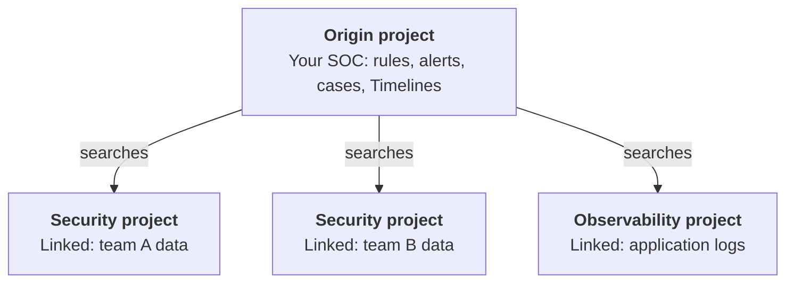

---
applies_to:
  stack: unavailable
  serverless: ga
products:
  - id: security
navigation_title: "Cross-project search"
description: Learn how cross-project search works in Elastic Security, what runs on the origin and linked projects, how to investigate across them, and which limits apply.
type: overview
---

# {{cps-cap}} in {{elastic-sec}} [sec-cross-project-search]

[{{cps-cap}} ({{cps-init}})](/explore-analyze/cross-project-search.md) lets one {{elastic-sec}} project search data in other {{serverless-short}} projects that you link to it. Your SOC can then run detections and investigations from one project, while each team's data stays in the project where it's ingested.

{{cps-cap}} is available for {{serverless-full}} projects only, and {{elastic-sec}} projects need the **Security Analytics Complete** [feature tier](/solutions/security/security-serverless-feature-tiers.md). For ECH, ECE, ECK, or self-managed deployments, use [{{ccs}}](/solutions/security/detect-and-alert/cross-cluster-search-detection-rules.md) instead.

If you lead a SOC or administer its projects, start with the [central SOC model](#sec-cps-central-soc) and the [limitations to plan around](#sec-cps-limitations) before you link projects. If you triage alerts, respond to attacks, or hunt for threats, go to [Triage and investigation across projects](#sec-cps-triage).

For {{cps-init}} concepts, configuration, and search syntax, refer to:

* [{{cps-cap}} overview](/explore-analyze/cross-project-search.md)
* [Configure {{cps}}](/deploy-manage/cross-project-search-config.md)
* [Manage {{cps}} scope in your project apps](/explore-analyze/cross-project-search/cross-project-search-manage-scope.md)

## Central SOC model [sec-cps-central-soc]

% REVIEW (#9222, open question 4): Confirm that "central SOC" is the customer-facing name for this model.

In a central SOC, your SOC works in one {{elastic-sec}} project, the _origin project_. Detection rules run there, and analysts triage alerts and investigate in Timeline and cases there. Each team, business unit, or environment keeps its own _linked project_, which continues to ingest its own data and manage its own agents and policies.

This model is the {{elastic-sec}} version of the [overview project](/deploy-manage/cross-project-search-config.md#cps-arch-overview) (hub-and-spoke) architecture. A general overview project starts empty. In a central SOC, the origin project is an {{elastic-sec}} project on the **Security Analytics Complete** tier, and it stores the alerts, cases, and Timelines that your SOC creates.



Searches and rules run from the origin project across the linked projects. Linked projects aren't linked to each other.

% REVIEW (#9222, open question 2): Should linked projects keep running their own detection rules in a central SOC? Add the recommendation here after the PM confirms.

## Origin and linked project responsibilities [sec-cps-responsibilities]

Use the following table to decide what each team owns. It shows where each part of a central SOC runs and keeps its data.

| Component | Location | Notes |
| --- | --- | --- |
| Data ingestion and {{agent}} | The linked project that owns the data | Each project keeps its own integrations and agents. |
| Detection rules | Origin project | By default, rules query linked-project data within the [space-level {{cps}} scope](/deploy-manage/cross-project-search-config/cps-config-access-and-scope.md#cps-default-search-scope). |
| Alerts from origin rules | Origin project | Includes alerts built from linked-project data. |
| Alerts that a linked project creates | That linked project | These alerts don't appear on the **Alerts** page of the origin project. |
| Cases | Origin project | You can't attach alerts or events from linked projects. |
| Timelines and notes | Origin project | Timeline shows documents from linked projects. Notes stay on the origin project. |
| Attack Discovery | Origin project | Uses origin project alerts only. |
| {{ml-cap}} jobs and results | Origin project | {{dfeeds-cap}} can read linked-project data. |
| Entity store | Each project | Entity profiles on the origin project include entities from linked projects. Risk scoring runs on the origin project only. |
| {{elastic-defend}} policies, artifacts, and response actions | The project where the host is enrolled | Managed through {{fleet}}. |
| Osquery saved queries and packs | Each project | Managed through {{fleet}}. |

For details about each app, refer to [{{elastic-sec}} app compatibility](#sec-cps-compatibility).

## Limitations to plan around [sec-cps-limitations]

Plan for these limits before you link projects. They're part of how {{cps-init}} works in {{elastic-sec}}, not errors that you can fix.

* **{{cps-cap}} is read-only.** From the origin project, you can search data in linked projects, but you can't change it. Most {{elastic-sec}} apps use the space's default {{cps}} scope, so set the [space-level scope](/deploy-manage/cross-project-search-config/cps-config-access-and-scope.md#cps-default-search-scope) before your analysts start triaging.
* **The Alerts page shows origin project alerts only, by design.** The **Alerts** page, Attack Discovery, and the alert widgets on the **Overview** page never merge in alerts that linked projects create on their own. To alert centrally on linked-project data, run detection rules on the origin project.
* **Alerts from linked projects can appear in other views, but you can't act on them.** {{cps-cap}} doesn't exclude alert indices, so Timeline, Discover, and visualizations that search alert indices can include alerts that linked projects created. From the origin project, you can't change the status, assignees, or tags of these alerts, add them to a case, add exceptions, or start response actions. Rules on the origin project that query alert indices, such as rules that alert on other alerts, might also read alerts from linked projects. Check the index patterns of those rules.
* **Entity analytics stay per project.** A host that appears in more than one project isn't combined into a single entity at the origin project, so expect one entity for each project the host appears in.
* **All projects must be in the same {{ecloud}} organization.** You can't link projects across organizations. {{ccs-cap}} can connect clusters across organizations. To compare the two, refer to [Compare {{cps}} and {{ccs}}](/explore-analyze/cross-project-search/cps-compared-to-ccs.md).
* **Each origin project can have up to 100 linked projects.** For the other limits that apply to all project types, refer to [{{cps-cap}} limitations](/deploy-manage/cross-project-search-config.md#cps-limitations).

% REVIEW (#9222, open question 1): The third limitation is the working definition of "remote-alert side effects", based on the Kibana source check posted on #9222. Confirm it with the PM. Whether rules that alert on other alerts actually read linked-project alerts hasn't been tested.

## Triage and investigation across projects [sec-cps-triage]

An investigation usually starts with an alert on the origin project and ends on the project where the affected host is enrolled. Each step belongs to a different role, though one person often fills several roles on a small team:

* **Triage analyst: Triage on the origin project.** Detection rules on the origin project create alerts from linked-project data, and those alerts appear on the **Alerts** page with your other alerts. Each alert records the {{cps}} scope that was in effect when the rule ran. For the fields, refer to [{{cps-cap}} context in alerts and the event log](/solutions/security/detect-and-alert/cross-project-search-detection-rules.md#cps-context-in-alerts).
* **Triage analyst: Open documents from linked projects.** In Timeline and other tables, documents from linked projects open in the flyout with a callout that says the document originates from a linked project. Actions that don't apply to these documents are unavailable, but **Investigate in Timeline** still works.
* **Incident responder or threat hunter: Investigate across projects.** [Timeline](/solutions/security/investigate/timeline.md) uses the space's default scope. Discover starts with the space default, and you can change its scope from the header. To see or control which projects a query searches, use {{esql}} in Discover, as the following examples show.
* **Incident responder: Respond on the project where the host is enrolled.** Host isolation and other [response actions](/solutions/security/endpoint-response-actions.md) work only for hosts enrolled in the current project. For a host enrolled in a linked project, these actions are unavailable from the origin project, even on an alert that the origin project created. To contain the host, respond from the project where it's enrolled.

% REVIEW (#9222, open question 3): "Respond from the project where it's enrolled" is inferred from the Kibana code. No UI text says so. Confirm with the PM.

### Example {{esql}} queries [sec-cps-esql-examples]

% REVIEW (#9222, open question 5): Run each example on a Serverless Security project with linked projects before publishing. They follow the documented syntax but haven't been tested.

The following queries show common patterns for investigations that span projects. For the full syntax, refer to [Query across {{serverless-short}} projects with {{esql}}](elasticsearch://reference/query-languages/esql/esql-cross-serverless-projects.md).

To find which project each event came from, add `_index` and `_project._alias` to `METADATA`:

```esql
FROM logs-endpoint.events.process-* METADATA _index, _project._alias <1>
| WHERE host.name == "web-server-01" <2>
| KEEP @timestamp, _project._alias, _index, process.name, user.name
| SORT @timestamp DESC
| LIMIT 50
```

1. `_index` returns the index name. For documents from linked projects, the name starts with the project alias and a colon. `_project._alias` returns the alias of the project the document came from, including the origin project. You must declare both fields in `METADATA` to use them later in the query.
2. Replace `web-server-01` with the host you're investigating.

To search a single project, add the project's alias and a colon before the index pattern. To search only the origin project, use `_origin:`. For details, refer to [Unqualified and qualified search expressions](/explore-analyze/cross-project-search/cross-project-search-search.md#search-expressions).

```esql
FROM emea-prod:logs-endpoint.events.*
| WHERE user.name == "jdoe"
| LIMIT 100
```

To search only the projects that match a tag, start the query with `SET project_routing`. The query skips projects that don't match. For more options, refer to [Project routing in {{cps-init}}](/explore-analyze/cross-project-search/cross-project-search-project-routing.md).

```esql
SET project_routing="_alias:emea-*";
FROM logs-endpoint.events.* METADATA _project._alias
| STATS events = COUNT(*) BY _project._alias
```

## {{elastic-sec}} app compatibility [sec-cps-compatibility]

% TODO (after #9113 merges): Move this table to /solutions/_snippets/cps-sec-compatibility.md, include it here and on cross-project-search-manage-scope.md, remove the per-app notes from that page, and add a pointer to this page at the top of its Security section and of the Security limitations in cross-project-search-config.md.
% REVIEW: The Timeline, Machine learning, and Entity store rows are copied from cross-project-search-manage-scope.md and conflict with other pages. Confirm with an SME whether the Timeline ES|QL tab honors SET project_routing, how prebuilt ML jobs fit "Read-only", and how the entity store reads linked data while its selector is "Not available".

{{elastic-sec}} apps have partial {{cps-init}} support. The following table shows, for each app, whether the {{cps-init}} scope selector is available and whether you can override that scope in a query. **Read-only** means the app uses the [space default](/deploy-manage/cross-project-search-config/cps-config-access-and-scope.md#cps-default-search-scope) and you can't change it from the header.

| App | {{cps-init}} scope selector | Query-level overrides |
| --- | --- | --- |
| **Alert, event, and attack flyouts** | Read-only | Not available |
| **Alerts** | Not available | Not available |
| **Attack Discovery** | Not available | Not available |
| **Cases** | Not available | Not available |
| **Cloud security** (CSPM, KSPM, CNVM) | Not available | Not available |
| **Dashboards** (Detection & Response, Data Quality) | Read-only | Not available |
| **Detection rules** | Read-only | Available |
| **{{elastic-defend}} and Osquery** | Read-only | Not available |
| **Entity store** | Not available | Not available |
| **Explore page** | Read-only | Not available |
| **Intelligence** | Read-only | Not available |
| **{{ml-cap}}** | Read-only | Not available |
| **Overview page** | Read-only (event widgets), not available (alert widgets) | Not available |
| **SIEM Readiness** | Not available | Not available |
| **Timeline** | Read-only | Not available |
| **Value report** | Not available | Not available |

Some apps have additional {{cps-init}} behavior:

- **Alert, event, and attack flyouts:** Documents from linked projects are clearly identified. Actions that don't apply to these documents are unavailable. **Investigate in Timeline** remains available. [Session View](/solutions/security/investigate/session-view.md) isn't available for documents from linked projects.
- **Alerts:** The **Alerts** page shows alerts that origin project rules create, including alerts built from linked-project data. It doesn't show alerts that a linked project creates on its own.
- **Cases:** You can't attach an alert or event from a linked project to a case.
- **Cloud security:** Cloud Security Posture Management (CSPM), Kubernetes Security Posture Management (KSPM), and Cloud Native Vulnerability Management (CNVM) show origin project data only. This includes the **Findings** and **Benchmarks** pages, the cloud security dashboards, and misconfiguration and vulnerability insights in flyouts.
- **Detection rules:** {{esql}} rules support `SET project_routing`. For non-{{esql}} rules that use index patterns, you can use [qualified index expressions](/explore-analyze/cross-project-search/cross-project-search-search.md#search-expressions). Origin project rules write alerts to the origin project. The **Max alerts per run** limit applies across the projects the rule queries. A rule searches only the linked projects that the user who last saved it can access. For details, refer to [{{cps-cap}} and detection rules](/solutions/security/detect-and-alert/cross-project-search-detection-rules.md).
- **{{elastic-defend}} and Osquery:** The **Endpoints** page, host details, **Response actions history**, and Osquery query results include data from the projects in the space's default {{cps}} scope. Policies, artifacts, response action dispatch, and Osquery saved queries and packs stay in each project because {{fleet}} manages them.
- **Entity store:** Entity profiles on the origin project include entities from every linked project. Each project still builds its own store, and risk scoring stays on the origin project. A host that appears in more than one project isn't combined into a single entity at the origin project.
- **{{ml-cap}}:** {{anomaly-detect-cap}} job {{dfeeds}} can [read data from linked projects](/explore-analyze/machine-learning/anomaly-detection/ml-ad-run-jobs.md#ml-ad-cps-scope). The origin project stores jobs and results. {{ml-cap}} rules alert on those stored results, including anomalies produced from linked-project data. Prebuilt jobs started from **ML job settings** search all linked projects and don't use the space default.
- **Timeline:** Uses the space default {{cps}} scope. Tables display documents from linked projects. Actions that don't apply to documents in linked projects are unavailable.

## Next steps [sec-cps-next-steps]

To set up a central SOC, an organization owner, or a project admin with admin access to the origin project and each linked project, does the following:

1. [Link projects](/deploy-manage/cross-project-search-config/cps-config-link-and-manage.md#cps-link-projects) to the origin project.
2. [Set the space-level {{cps}} scope](/deploy-manage/cross-project-search-config/cps-config-access-and-scope.md#cps-default-search-scope) that {{elastic-sec}} apps use.

Detection engineers can then review how [detection rules work with {{cps}}](/solutions/security/detect-and-alert/cross-project-search-detection-rules.md), including which credentials a rule uses and how the **Max alerts per run** limit applies across projects.

## Related pages [sec-cps-related]

* [How search works in {{cps-init}}](/explore-analyze/cross-project-search/cross-project-search-search.md)
* [Project routing in {{cps-init}}](/explore-analyze/cross-project-search/cross-project-search-project-routing.md)
* [Compare {{cps}} and {{ccs}}](/explore-analyze/cross-project-search/cps-compared-to-ccs.md)
* [{{esql}} for security](/solutions/security/esql-for-security.md)
